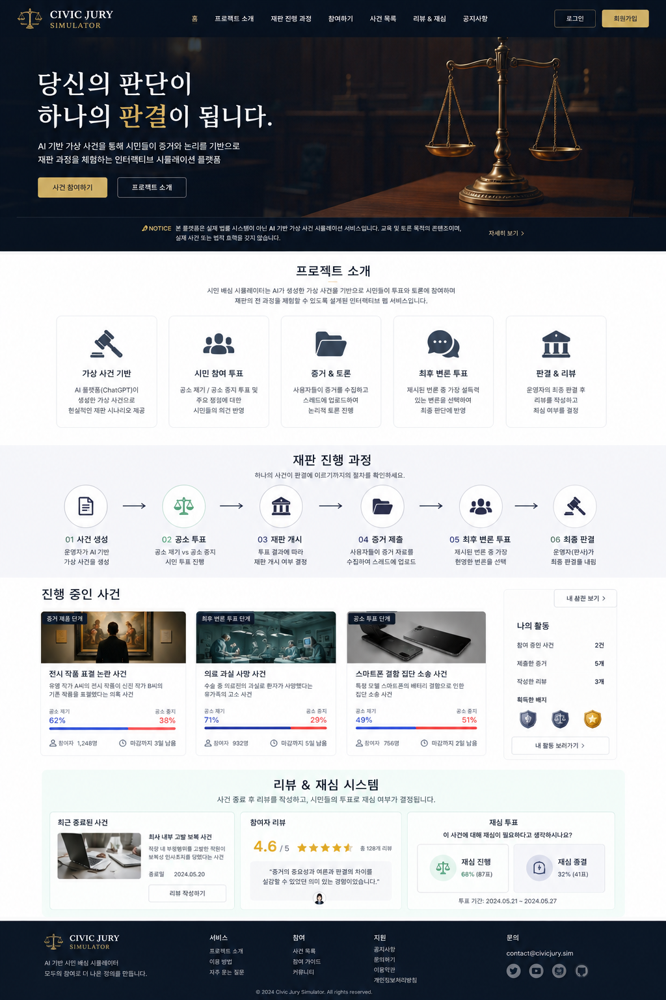

# 01. 서비스 정의

## 한 줄 정의

- 가상 사건의 배심원이 된 사용자가 AI 가상 형사 소송 사건을 통해 소송의 절차와 법정 사건을 경험하며, 재판의 주요 시스템을 이해하는 것이 이 서비스의 목표로 합니다.

- 웹 사이트 기획 및 제작자인 Code-Name-JS는 대한민국의 국민으로써 국민들이 느끼는 사법 부패와 불신의 주요 원인을 법률 시스템에 대한 절차의 이해가 부족하다는 것으로 보며 법정 경험을 웹사이트 인터페이스를 통해 시뮬레이션할 수 있도록 설계된 대규모 단기 웹 프로젝트입니다.

---

## 사용자

- 법·행정 공부하는 학생
- 국민참여재판 배심원 통지를 받은 시민
- 법정물을 좋아하는 일반인

---

## 기대되는 사용자

- 미래를 위해 형사 고소와 소송 절차를 체험해보고 법정 경험을 쌓고 싶은 사용자
- 법정에서 배심원이 되어 가상 사건의 과정과 결말을 알고, 참여하고 싶은 사용자
- 가상 사건을 통해 공소를 제기하고 중지시켜보고 싶은 사용자
- 가상 법정 시뮬레이션의 체험으로 소송의 과정과 결말을 게임 형식으로 가볍게 체험하며 법정 지식과 경험을 쌓고 싶은 서비스를 이용하는 사용자들이 본 서비스의 사용자에 대한 정의입니다.

---

## 실제로는 이렇습니다

| 문서 속 사용자 행동 | 실제 법정에서 이 일을 하는 사람 |
|---|---|
| 공소 제기를 투표로 정함 | 검사(한국은 검사만 기소할 수 있음) |
| 증거 제출, 변론 정보 공유 | 검사/변호인 |
| 최종 변론 | 변호인·피고인(검사는 '논고·구형') |
| 리뷰로 항소 | 검사/피고인(배심원은 항소할 수 없음) |

실제 배심원(국민참여재판)은 듣고 판단하는 사람이라 증거를 내거나 변론하지 않습니다. 본 서비스에서는 검사 측과 변호 측 팀원을 나누는 것이 서비스를 이용하는 사용자들에게 서비스를 쉽게 이용하는 방식에서 맞지 않다고 판단하여 배심원이라는 표현으로 모든 과정을 배심원이 경험할 수 있게 유도합니다.

---

## 이 서비스가 할 수 있는 것 / 하지 못하는 것

| 할 수 있다 | 할 수 없다 |
|---|---|
| AI·운영자는 소송 사건을 업로드할 수 있다 | 사용자인 배심원들은 소송 사건을 업로드하지 못한다 |
| 사용자인 배심원들은 공소 제기와 공소 중지의 판결을 투표로 판결할 수 있다 | AI·운영자는 사용자들의 투표로 소송 사건의 시작과 중지 투표를 조작하지 못한다 |
| 공소 중지된 사건은 패기 될 수 있지만 다른 사건으로 업로드될 수 있다 | 투표 조작 문제로 공소 중지된 사건을 동일한 이름/사건ID/내용으로 다시 업로드할 수 없다 |
| 공소 제기의 비율이 높을 경우 검사 청구를 운영자가 시작한다 | 공소 제기의 검사 청구는 AI가 할 수 없다  |
| 공소 제기를 투표한 사람들은 공판준비절차에 서면하게 된다 | 공소 제기를 투표하지 못한 사람들은 공판준비절차에 서면할 수 없다 |
| 공판준비절차 서면은 해당 사건이 AI 플랫폼을 통해 만들어진 가짜 사례임을 확인하는 서면을 한다 | 공판준비절차 서면에 이의를 제기하면 본 서비스를 이용할 수 없다 |
| 공소 제기한 사람들과 공소 중지를 투표한 사람들은 증거자료 또는 변론을 위해 정보를 각자 공유할 수 있는 스레드 게시판을 운영자가 생성해 준다 | 서로의 증거자료 및 변론을 위한 정보 유출에 대한 정보를 보호할 수 없다 |
| 심리단계에서 해당 사건의 문제를 증거자료와 정보를 제외하고 대표 배심원 1명만이 최종 변론할 수 있다 | 최종 변론은 운영자 및 이 사건에 참여하는 배심원들이 임의로 최종 변론을 할 수 없다 |
| 결론 단계에서 판결선 고지 후 선고를 진행하는데 운영자의 결정으로 선고하지만 배심원의 평결을 참고해서 선고한다 | 운영자의 결정으로 선고한 판결선 고지는 무죄, 형량: 징역·집행유예·벌금, 유죄로 결정나고 선고의 이유를 제공하는 것과 함께 이의 제기는 받지 않는다 |
| 운영자의 선고한 판결선 고지에 이의 제기에 합법적으로 항소할 수 있게 참여 리뷰 작성을 할 수 있다 | 리뷰 작성을 하지 않는 배심원 참여자는 선고의 결과를 이의 제기할 수 없다 |
| 리뷰 기간 안에만 항소 신청 가능하다 | 판결 즉시는 이의 불가하다 |
| 운영자는 배심원 참여자들의 리뷰 작성을 보고 다시 한번 같은 사건을 2심 재판으로 결정할 수 있으며 다시 사건을 진행할 수 있다 | 2심 재판은 리뷰 작성을 하지 않으면 일어날 수 없다 또한 리뷰들이 재판 이의 신청이 아니라면 일어나지 않는다 |
| 본 서비스는 게임 규칙상 2심(항소심)까지만 진행한다 | 2심 이상으로 재판이 일어나지 않는다 |

---

## 핵심 흐름

1. AI 사건 생성
2. 공소 투표(공소제기/공소중지)
3. 재판 개시(공판준비절차 서면)
4. 스레드 생성(피해자/가해자)
5. 증거 제출(다양한 문제 해결을 위한 증거자료 수집)
6. 최후 변론인 투표(문제 해결에 가까운 배심원을 뽑기)
7. 최종 판결(운영자의 결정/선고 이유 제공/이의 제기 신청 불가능)
8. 리뷰(배심원들의 참여 리뷰/이의 제기 신청 가능)
9. 리뷰에 따른 2심을 운영자가 결정
10. 운영자의 결정으로 2심이 시작되면 다시 4번으로 돌아가 진행

---

## AI의 가상 사건 투표 방식

- 공소 제기와 공소 중지의 투표는 %지로 표현되며, 높은 수치의 %가 사건의 시작을 알리고 끝냅니다.
- 최소 참여 인원은 50명 미만으로 배심원은 딱 1개의 사건에만 참여할 수 있습니다. 사건의 용도에 따라 참여 인원수는 변경됩니다.
- 다른 아이디로 다른 사건에 참여한 것이 발켜지면 본 서비스를 이용하는데 불이익을 받을 수 있습니다.
- 투표 기간은 일주일 또는 한 달로 잡고 증거 제출 기간은 한 달로 진행됩니다. 리뷰 기간은 일주일간 진행됩니다.
- 문제 해결에 가까운 최종 변론인 배심원을 추첨하는 방식은 배심원들이 결정합니다. 그리고 추천 변론인을 뽑는 사람은 AI 플랫폼의 의사결정에 따릅니다.
- 본 AI를 통해 만들어진 가상 사건은 실존 인물이나 사건과 비슷해지지 않는 AI 플랫폼의 특징인 환각을 통해 만들어진 범죄 유형입니다. 법률 자문이 아닌 것을 확인하고 진행하도록 공판준비절차 서면에 싸인합니다.
