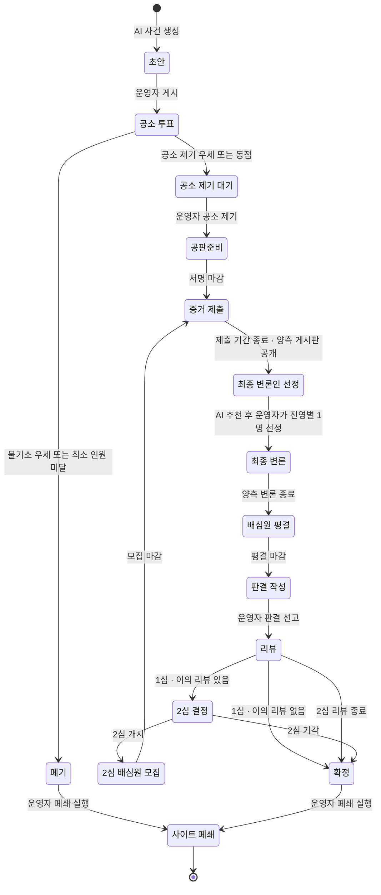
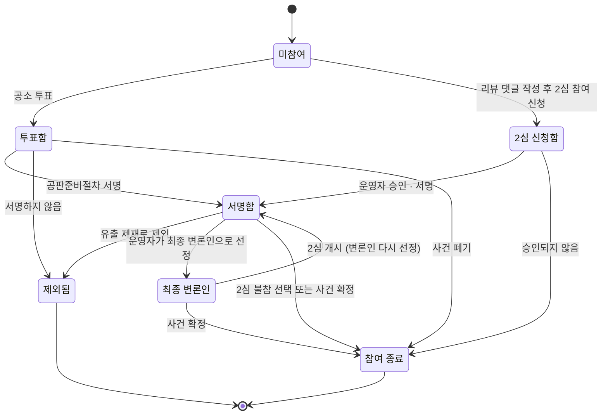

# 02. 사건 생애주기

사건 하나가 생성되어 폐기 또는 확정될 때까지 거치는 상태, 상태가 바뀌는 조건, 각 단계에서 누가 무엇을 할 수 있는지 정의합니다. 규칙의 근거는 [01. 서비스 정의](./01-service-definition.md)입니다. 결정한 내용과 아직 남은 질문은 맨 아래 [결정 기록](#결정-기록)에 모았습니다.

01의 [한 사이트, 한 사건](./01-service-definition.md#한-사이트-한-사건) 원칙에 따라 **사이트 하나에는 사건이 1건만 있고, 이 문서의 생애주기는 곧 사이트의 생애주기입니다.** 사건이 폐기되거나 확정되면 사이트는 폐쇄됩니다.

---

## 상태 흐름도

- 사건에는 `심급` 값(1심/2심)이 있습니다. 2심은 **2심 배심원 모집**을 거친 뒤 **증거 제출**부터 다시 진행하고, 공소 투표와 공판준비는 반복하지 않습니다.
- 사건이 끝나는 상태는 **폐기**와 **확정** 두 가지이고, 어느 쪽이든 그다음은 **사이트 폐쇄**입니다.

---

## 상태별 정의

기간은 기본값이며, 운영자는 시연이나 테스트를 위해 **사건을 게시하기 전에** 조정할 수 있습니다. 이미 진행 중인 단계의 기간은 바꿀 수 없습니다. 투표 도중에 기간을 바꿔 결과에 영향을 주는 일을 막기 위해서입니다.

| # | 상태 (코드) | 기간 | 진입 조건 | 다음 상태로 가는 조건 | 진행 주체 |
|---|---|---|---|---|---|
| 1 | 초안 (`DRAFT`) | 정하지 않음 | AI가 사건을 생성함 (사이트당 1건) | 운영자가 검수 후 게시 | AI 생성, 운영자 게시 |
| 2 | 공소 투표 (`INDICTMENT_VOTE`) | 1주 또는 1달 | 운영자 게시 | 기간 만료 시 참여 인원과 득표율 확인 | 배심원 투표 |
| 3 | 폐기 (`DISMISSED`) | 운영자가 정함 | 불기소 득표율이 더 높음, 또는 참여자가 최소 인원 미달 (연장 없음) | 운영자가 사이트 폐쇄 실행 (새 사건을 올릴 수 없음) | 시스템, 운영자 |
| 4 | 공소 제기 대기 (`INDICTMENT_PENDING`) | 3일 이내 | 공소 제기 득표율이 더 높거나 같음 | 운영자가 공소 제기 실행 | 운영자 (AI는 공소 제기 불가) |
| 5 | 공판준비 (`PRETRIAL`) | 3일 | 운영자 공소 제기 | 서명 기간 만료 | 투표 참여 배심원 서명 |
| 6 | 증거 제출 (`EVIDENCE`) | 1달 | 서명 마감, 또는 2심 모집 마감 | 기간 만료 시 양측 게시판 공개 | 운영자 진영 게시판 생성, 배심원 개인 스레드 작성 |
| 7 | 최종 변론인 선정 (`ADVOCATE_SELECTION`) | 1주 | 증거 제출 기간 종료 | 추천 투표 마감 → AI 추천 → 운영자가 진영별 1명씩 단 한 번 선정 | 배심원 추천 투표, AI 추천, 운영자 선정 |
| 8 | 최종 변론 (`FINAL_ARGUMENT`) | 3일 | 최종 변론인 확정 | 양측 변론 제출 또는 기간 만료 | 진영별 대표 배심원 1명씩 |
| 9 | 배심원 평결 (`DELIBERATION`) | 3일 | 최종 변론 종료 | 기간 만료 | 배심원 평결 투표 (비공개) |
| 10 | 판결 작성 (`SENTENCING`) | 3일 | 평결 마감 | 운영자가 판결 선고 | 운영자 |
| 11 | 리뷰 (`REVIEW`) | 1주 | 판결 선고 | 기간 만료 시 심급과 이의 리뷰 여부 확인 | 배심원 리뷰·항소 신청, 사용자 댓글 |
| 12 | 2심 결정 (`APPEAL_DECISION`) | 3일 | 1심 리뷰 기간 종료 + 이의 리뷰 1건 이상 | 운영자가 2심 개시 또는 기각 | 운영자 |
| 13 | 2심 배심원 모집 (`APPEAL_RECRUITMENT`) | 3일 | 운영자가 2심 개시 결정 | 모집 기간 만료 | 1심 배심원 참여 선택, 신청자 지원, 운영자 승인 |
| 14 | 확정 (`FINALIZED`) | 운영자가 정함 | 이의 리뷰 없음, 2심 기각, 또는 2심 리뷰 종료 | 운영자가 사이트 폐쇄 실행 | 시스템, 운영자 |
| 15 | 사이트 폐쇄 (`SITE_CLOSED`) | 끝 | 운영자가 폐쇄 실행 | 없음. 종료 안내 페이지만 남고 모든 기능 중단, 회원 정보 파기 | 운영자 |

**단계별 세부 규칙**
- **공소 투표 · 인원 미달**: 마감 시 참여자가 최소 인원 50명에 못 미치면 **연장 없이 바로 폐기**되고 사이트 폐쇄로 넘어갑니다. 운영자가 판단할 여지가 없으므로 시스템이 자동으로 처리합니다. 참여자를 모으지 못한 것은 운영자의 홍보와 운영 역량의 결과로 봅니다.
- **공소 투표 · 동점**: 공소 제기로 처리해 재판을 엽니다. 증거로 다퉈 볼 기회를 주는 쪽을 택한 것입니다.
- **공판준비 · 미서명자**: 공소 투표는 했지만 서명하지 않은 배심원의 표는 득표율에 그대로 남고, 그 배심원은 재판 단계부터 제외됩니다. 이미 확정된 투표 결과가 나중에 바뀌는 혼란을 막기 위해서입니다.
- **최종 변론인 선정 기간 나누기**: 단계 기간의 **앞 절반은 배심원 추천 투표**, 뒤 절반은 AI 추천과 운영자 선정 기간입니다 (M3 구현에서 정함).
- **최종 변론인 선정**: 1주 안에 세 단계를 거칩니다. ① 배심원 추천 투표(추천 이유 작성) → ② 추천 마감 후 AI가 후보들이 쓴 글을 분석해 진영별 추천과 이유를 냄 → ③ 운영자가 AI의 설명과 배심원의 추천 이유를 참고해 진영별 1명을 **단 한 번** 선정. 선정 후에는 바꿀 수 없고, AI 추천·운영자 선정·(다르게 선정했다면) 그 이유를 모두 공개합니다.
  - 운영자가 단계 마감까지 선정하지 않으면 **AI의 추천이 그대로 확정**됩니다.
  - AI가 응답하지 않으면 AI 추천 없이 운영자가 선정하고, AI 추천이 없었다는 사실을 공개합니다. 이 경우에도 운영자가 마감까지 선정하지 않으면 추천 표를 가장 많이 받은 후보로 확정합니다.
- **최종 변론**: 실제 재판의 순서(검사 논고 → 변호인 최종 변론)에 맞춰 공소 제기 측이 먼저, 불기소 측이 나중에 변론합니다.
- **판결 선고 → 리뷰**: 판결을 선고하면 리뷰 기간이 시작됩니다. 1심 리뷰에 이의 신청이 1건이라도 있으면 리뷰 마감 후 2심 결정으로, 없으면 확정으로 넘어갑니다. (MVP에서는 리뷰 없이 바로 확정됐고, M5에서 리뷰·2심을 붙였습니다.)
- **리뷰 댓글 기간**: 리뷰 댓글은 리뷰 기간과 2심 결정 기간에만 받습니다. 2심이 열린 뒤에는 댓글을 받지 않아, 2심 개시를 보고 한쪽 진영에 사람을 채우려고 댓글을 다는 일을 막습니다 (M5 구현에서 정함).
- **2심 배심원 모집 기간 나누기**: 단계 기간의 **앞 절반은 1심 배심원의 참여 선택과 추가 배심원 신청**, 뒤 절반은 승인된 신청자의 서명 기간입니다. 신청 마감이 지나면 시스템이 운영자가 공개한 승인 기준을 그대로 적용하고 결과를 진행 기록에 공개합니다. 마감까지 참여 여부를 고르지 않은 1심 배심원은 2심에 참여하지 않습니다 (M5 구현에서 정함).
- **2심 기간**: 2심 배심원 모집부터 리뷰까지의 단계 기간은 운영자가 게시 전에 정한 기간을 그대로 다시 씁니다.
- **2심 리뷰**: 2심 판결 뒤에도 리뷰는 받지만, 3심은 열리지 않으므로 항소 신청은 받지 않습니다. 리뷰는 교육용 피드백으로만 씁니다.
- **폐기 · 확정 → 사이트 폐쇄**: 사건이 끝나면 운영자가 폐쇄 일시를 공지하고 폐쇄를 실행합니다. 폐쇄 전까지 배심원은 결과를 확인할 수 있습니다. 폐쇄 후에는 종료 안내 페이지("이 사건은 종료되었습니다"와 결과 요약)만 남고, 회원 정보는 파기합니다. 폐쇄까지의 기간과 파기 방법은 운영자가 정합니다.

---

## 2심 진행 방식

| 항목 | 내용 |
|---|---|
| 1심 배심원 | 1심에서 서명한 배심원은 2심 참여 여부를 직접 선택합니다. 참여하면 **1심 진영을 그대로 유지**합니다 |
| 추가 배심원 | 1심 리뷰에 댓글을 단 사용자는 2심 참여를 신청할 수 있습니다. 신청할 때 **진영을 직접 선택**합니다 |
| 승인 | 운영자는 2심을 열 때 승인 기준과 진영별 추가 인원 상한을 정해 공개하고, 신청 마감 후 시스템이 그 기준을 그대로 적용해 승인합니다. 승인된 사람은 모집 마감 전에 공판준비절차 서명을 한 뒤 참여합니다 |
| 공정성 | 운영자는 승인 기준과 진영별 추가 인원을 사건 페이지에 공개합니다. 한쪽 진영에만 사람을 채워 결과를 움직이는 일을 막기 위해서입니다. 승인은 진영별 같은 수로 하고, 신청자가 많으면 추첨합니다 ([05](./05-policy-and-risk.md#2심-추가-배심원-승인-기준)) |
| 게시판 | 2심용 진영 게시판을 새로 만듭니다. 1심 게시판은 읽기 전용으로 보관하며 2심 배심원 모두 읽을 수 있습니다 |
| 설득 지표 | 2심이 시작될 때의 진영별 인원 비율과 2심 평결 결과를 비교합니다 |

---

## 상태별로 배심원이 할 수 있는 일

| 상태 | 배심원이 할 수 있는 일 | 할 수 없는 일 |
|---|---|---|
| 초안 | — (공개되지 않음) | 사건 열람 |
| 공소 투표 | 사건 개요 열람, 공소 제기/불기소 중 하나에 투표 | 여러 계정으로 투표, 진행 중 득표율 확인 |
| 공소 제기 대기 | 투표 결과 확인 | 투표 변경 |
| 공판준비 | 공판준비절차 서명 (AI가 만든 허구 사건이며 법률 자문이 아님을 확인) | 투표하지 않은 사람의 서명 |
| 증거 제출 | 자기 측 게시판 열람, 개인 스레드 작성(생각·증거자료) | 상대 측 게시판 열람·글 쓰기, 유출·유출 정보 게시 (적발 시 제재) |
| 최종 변론인 선정 | 자기 측 후보 추천 투표(추천 이유 작성), 공개된 양측 게시판 열람, AI 추천과 운영자 선정 결과 확인 | 최종 변론인 직접 지정, 게시판에 새 글 쓰기 |
| 최종 변론 | 양측 최종 변론 열람 (대표 배심원은 변론 작성) | 대표 배심원 외 변론 작성 |
| 배심원 평결 | 유죄/무죄 평결 투표 (개인 표 비공개) | 진행 중 득표율 확인 |
| 판결 작성 | 대기 | 판결 개입 |
| 리뷰 | 참여 리뷰 작성, 리뷰에 이의 신청 포함 (1심만) | 리뷰 기간 밖의 항소 신청, 2심 판결에 대한 항소 |
| 2심 결정 | 대기 | 2심 여부 투표 |
| 2심 배심원 모집 | 2심 참여 여부 선택 | 진영 변경 |
| 폐기 · 확정 | 결과 열람 (사이트 폐쇄 전까지) | 이의 제기 |
| 사이트 폐쇄 | 종료 안내 페이지 열람 | 로그인 등 모든 기능 |

---

## 배심원의 진행 상태

사건 상태와 별개로, 배심원 한 명은 사건 안에서 아래 단계를 거칩니다.

- **진영은 투표로 정해집니다.** 공소 제기에 투표하면 공소 제기 측(검사 역할), 불기소에 투표하면 불기소 측(변호 역할) 게시판에 들어갑니다. 2심 추가 배심원은 신청할 때 진영을 고릅니다. 진영 게시판에 글을 쓰는 순간 자신의 입장이 드러납니다.
- **한 사람은 계정 하나로만, IP 하나에는 계정 하나만** 참여합니다. 사이트에 사건이 1건뿐이므로, 같은 사람이 여러 계정으로 양쪽 진영에 들어가거나 같은 네트워크의 사람들이 함께 짜고 움직이는 것이 이 서비스에서 가장 경계해야 할 부정행위입니다. 접속 IP가 바뀌면 이메일 인증을 거칩니다 ([01. 투표와 참여 규칙](./01-service-definition.md#투표와-참여-규칙)).

---

## 진영 게시판 규칙

증거 제출 단계에서 운영자가 공소 제기 측과 불기소 측 게시판을 하나씩 만듭니다. 배심원은 자기 측 게시판에 X(구 트위터)처럼 개인 스레드를 작성합니다.

| 단계 | 자기 측 게시판 | 상대 측 게시판 |
|---|---|---|
| 증거 제출 | 읽기 · 쓰기 | 읽을 수 없음 |
| 최종 변론인 선정 ~ 확정 | 읽기 (쓰기 마감) | 읽기 (공개) |
| 폐기 · 확정 이후 | 읽기 (사건 기록으로 보관) | 읽기 |

- 증거 제출 기간에는 정보가 각 진영의 자원입니다. 상대의 전략을 모른 채 자기 측의 주장과 증거를 쌓습니다.
- 증거 제출 기간이 끝나면 양측 게시판이 모두 공개되고, 동시에 읽기 전용이 됩니다. 배심원은 양측의 주장과 증거를 모두 본 뒤 최종 변론인 추천과 평결에 참여합니다.
- 서명하지 않아 제외된 배심원은 게시판에 글을 쓸 수 없습니다.
- 판결 선고 후에는 사건에 참여하지 않은 로그인 사용자도 양측 게시판과 최종 변론을 읽을 수 있습니다. 리뷰에 댓글을 달고 2심을 신청하려면 사건 내용을 알아야 하기 때문입니다. 화면별 접근 권한은 [03. 접근 권한](./03-information-architecture.md#접근-권한)을 따릅니다.

### 정보 유출과 제재

본 서비스는 배심원 사이의 정보 유출을 기술적으로 막지 않고 그 결과에 책임지지 않지만, 적발되면 제재할 수 있습니다. 원칙은 [01. 정보 유출과 제재](./01-service-definition.md#정보-유출과-제재)를 따릅니다.

| 항목 | 내용 |
|---|---|
| 문제가 되는 시기 | 증거 제출 기간 (기간이 끝나면 어차피 양측 게시판이 공개되므로) |
| 제재 대상 | 자기 측 정보를 상대 측에 유출한 배심원, 유출된 정보를 상대 측 게시판에 게시한 배심원 |
| 탐지 방법 | 열람자별 워터마크, 복사 글 탐지, 비정상 열람 탐지, 배심원 신고 |
| 제재 단계 | 경고 → 게시판 쓰기 제한 → 사건에서 제외 |
| 이의 신청 | 제재를 받은 배심원은 이의를 신청할 수 있음 |

- '사건에서 제외'되면 배심원의 진행 상태는 **제외됨**이 되고, 이후 그 사건의 투표와 게시판에 참여할 수 없습니다. 사이트에 다음 사건이 없으므로 이것이 가장 무거운 제재입니다.

---

## 투표 공개 원칙

| 투표 | 진행 중 | 마감 후 | 이유 |
|---|---|---|---|
| 공소 투표 | 득표율 숨김 | 득표율 공개. 개인 입장은 진영 게시판을 통해 드러남 (증거 제출 기간에는 같은 진영 안에서만) | 게시판은 공소 제기 이후에 생기므로 투표 중에는 개인 입장이 드러나지 않음. 앞선 투표가 뒤 투표에 영향을 주는 것을 막음 |
| 최종 변론인 추천 | 득표율 숨김 | 결과 공개 | 인기투표처럼 쏠리는 것을 막음. 각 진영은 자기 측 후보에게만 투표 |
| 배심원 평결 | 득표율 숨김 | 합계만 공개, 개인 표 비공개 | 상대 측 증거에 설득된 배심원이 눈치 보지 않고 처음 입장과 다르게 투표할 수 있게 함 |

**설득 지표**: 판결 화면에 공소 투표 결과와 평결 결과를 나란히 보여 줍니다. 예를 들어 "공소 제기 62% → 유죄 평결 48%"는 불기소 측의 증거가 배심원 14%p를 설득했다는 뜻입니다. 이 차이가 "증거로 사건의 결말을 증명한다"는 핵심 경험이 실제로 일어났는지 보여 줍니다.

---

## 주체별 권한

'사용자'는 사건에 참여하지 않은 로그인 사용자입니다. 빈칸은 해당 없음입니다.

| 행동 | AI | 운영자 | 배심원 | 사용자 | 시스템 |
|---|---|---|---|---|---|
| 사건 생성 | O | O | X | X | |
| 사건 게시 · 단계별 기간 조정 (게시 전에만) | X | O | X | X | |
| 공소 투표 | X | X | O | X | |
| 투표 결과 조작 | X | X | X | X | |
| 득표율 집계·상태 전환 | | | | | O |
| 공소 제기 (재판 개시) | X | O | X | X | |
| 진영 게시판 생성 | X | O | X | X | |
| 자기 측 게시판에 스레드 작성 | X | X | O (증거 제출 기간에만) | X | |
| 상대 측 게시판 열람 | | O | 증거 제출 기간 종료 후 | 판결 선고 후 (양측 게시판·최종 변론) | |
| 상대 측 게시판에 글 쓰기 | X | X | X | X | |
| 유출 탐지 | | | | | O |
| 유출 제재 | X | O | X | X | |
| 제재 이의 신청 | X | X | O | X | |
| 최종 변론인 후보 추천 | X | X | O (자기 측 후보만) | X | |
| 최종 변론인 추천 (후보 글 분석) | O (진영별 1명 추천, 이유 공개) | X | X | X | |
| 최종 변론인 최종 선정 | X | O (진영별 1명, 단 한 번, AI 추천과 다르면 이유 공개) | X | X | |
| 최종 변론 | X | X | 진영별 대표 1명씩 | X | |
| 평결 | X | X | O | X | |
| 판결 선고 | X | O | X | X | |
| 리뷰 작성·항소 신청 | X | X | O (1심 리뷰 기간에만 항소) | X | |
| 리뷰에 댓글 작성 | X | | O | O | |
| 2심 결정 | X | O | X | X | |
| 2심 참여 신청 | X | X | 참여 여부 선택 | O (리뷰 댓글 작성자) | |
| 2심 추가 배심원 승인 | X | O (기준·인원 공개) | X | X | |
| 사이트 폐쇄 · 회원 정보 파기 | X | O | X | X | |

---

## 예상 소요 기간

| 구간 | 최소 | 최대 |
|---|---|---|
| 공소 투표 | 1주 | 1달 |
| 공소 제기 대기 + 공판준비 | 6일 | 6일 |
| 증거 제출 | 1달 | 1달 |
| 변론인 선정 + 최종 변론 + 평결 + 판결 작성 | 16일 | 16일 |
| 리뷰 | 1주 | 1주 |
| **1심 합계** | **66일 (약 9.5주)** | **89일 (약 13주)** |
| 2심 (결정 3일 + 모집 3일 + 증거 제출부터 리뷰까지) | 59일 (약 8.5주) | 59일 (약 8.5주) |

시연이나 테스트 때는 사건을 게시하기 전에 운영자가 각 기간을 짧게 조정합니다.

---

## 결정 기록

### 결정된 사항

| # | 질문 | 결정 |
|---|---|---|
| 1 | 공소 투표 마감 시 최소 인원 50명 미달이면? | 연장 없이 바로 폐기, 사이트 폐쇄 (05 결정으로 변경. 처음에는 '운영자가 연장 또는 폐기 결정'이었음) |
| 2 | 공소 제기와 불기소 득표율이 같으면? | 공소 제기 (재판 개시) |
| 3 | 투표 중에 실시간 득표율을 보여 줄까? | 모든 투표는 진행 중 숨김, 마감 후 공개. 평결만 개인 표 비공개 ([투표 공개 원칙](#투표-공개-원칙)) |
| 4 | 01에 없는 단계별 기간은? | 공소 제기 대기 3일 이내, 공판준비 3일, 변론인 선정 1주, 최종 변론 3일, 평결 3일, 판결 작성 3일, 2심 결정 3일. 운영자가 사건 게시 전에 조정 가능 |
| 5 | 최종 변론인 수는? | 진영별 1명씩 |
| 6 | 배심원 평결 단계를 01 핵심 흐름에 넣을까? | 추가 (01 핵심 흐름 8번) |
| 7 | 서명하지 않은 배심원의 공소 투표 표는? | 득표율에 그대로 유지, 재판 단계부터 제외 |
| 8 | 2심 판결 뒤에도 리뷰를 받는가? | 받되 항소는 불가 |
| 9 | 2심 진영 게시판은? | 새로 만들고 1심 게시판은 읽기 전용으로 보관 |
| 10 | 2심에는 누가 참여하는가? | 참여를 선택한 1심 서명자 + 리뷰에 댓글을 달고 신청한 사용자 중 운영자가 승인한 사람 ([2심 진행 방식](#2심-진행-방식)) |
| 11 | 상대 측 게시판을 읽을 수 있는가? | 증거 제출 기간에는 자기 측만, 기간이 끝나면 양측 모두 공개. 글은 언제나 자기 측에만 씀 ([진영 게시판 규칙](#진영-게시판-규칙)) |
| 12 | 정보 유출은 어떻게 다루는가? | 기술적으로 막지 않고 책임지지 않되, 유출한 사람과 유출 정보를 게시한 사람 모두 제재 ([정보 유출과 제재](#정보-유출과-제재)) |
| 20 | 사이트에 사건을 몇 건 올리나? | 1건. 사건이 끝나면 사이트 폐쇄 ([01. 한 사이트, 한 사건](./01-service-definition.md#한-사이트-한-사건)) |
| 21 | 폐기되면(불기소·인원 미달) 새 사건을 올릴 수 있나? | 올릴 수 없음. 폐기도 사건의 결말로 보고 사이트 폐쇄 |
| 22 | 폐쇄는 어떤 형태인가? | 종료 안내 페이지("이 사건은 종료되었습니다"와 결과 요약)만 남기고 모든 기능 중단 |
| 23 | 폐쇄 시 개인정보는? | 회원 정보 파기. 구체적인 처리는 운영자가 정함 |
| 24 | 최종 변론인은 누가 최종 선정하나? | 배심원 추천(이유 포함) → AI가 후보 글을 분석해 추천과 이유 제시 → **운영자가 진영별 1명을 단 한 번 선정**. 판결이 뒤집힐 수 있는 핵심 구간 (처음에는 'AI가 최종 선정'이었음) |
| 25 | 리뷰 댓글은 언제까지 받나? (M5) | 리뷰 기간과 2심 결정 기간. 2심이 열리면 받지 않음 |
| 26 | 2심 모집 기간은 어떻게 쓰나? (M5) | 앞 절반은 참여 선택·신청, 마감 후 시스템이 승인 기준 적용, 뒤 절반은 승인자 서명. 고르지 않은 1심 배심원은 불참 |

### 남은 질문

위 결정을 문서에 옮기면서 생긴 세부 질문입니다. 아래 기본값을 문서에 먼저 반영해 두었습니다.

| # | 질문 | 문서에 반영한 기본값 |
|---|---|---|
| 13 | 제재 단계별 적발 기준(몇 번째 적발에 어느 단계)은? | 05 [제재 정책](./05-policy-and-risk.md#제재-정책)에서 정함 |
| 14 | 2심 추가 배심원의 진영은 어떻게 정하나? | 신청할 때 직접 선택 |
| 15 | 1심 배심원은 2심에서 진영을 바꿀 수 있나? | 바꿀 수 없음 (1심 진영 유지) |
| 16 | 운영자가 2심 추가 배심원을 승인하는 기준은? | 진영별 같은 수로 승인하고, 신청자가 많으면 추첨. 05 [2심 추가 배심원 승인 기준](./05-policy-and-risk.md#2심-추가-배심원-승인-기준)에서 정함. M5에서 신청 마감 후 시스템이 기준을 적용하도록 구현 |
| 17 | ~~인원 미달 시 운영자가 투표를 몇 번까지 연장할 수 있나?~~ | 해당 없음. 연장 없이 바로 폐기 (결정 1) |
| 18 | 최종 변론인 추천 투표는 누가 누구에게 하나? | 각 진영 배심원이 자기 측 후보에게만 투표 |
| 19 | 양측 최종 변론 순서는? | 공소 제기 측 먼저, 불기소 측 나중 (실제 재판 순서) |
