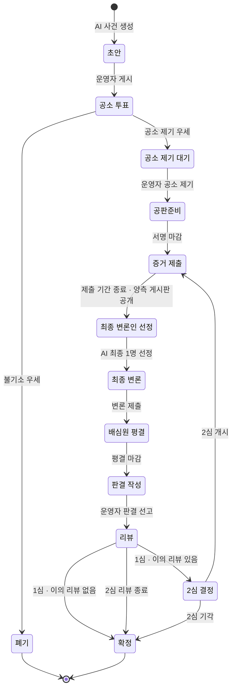
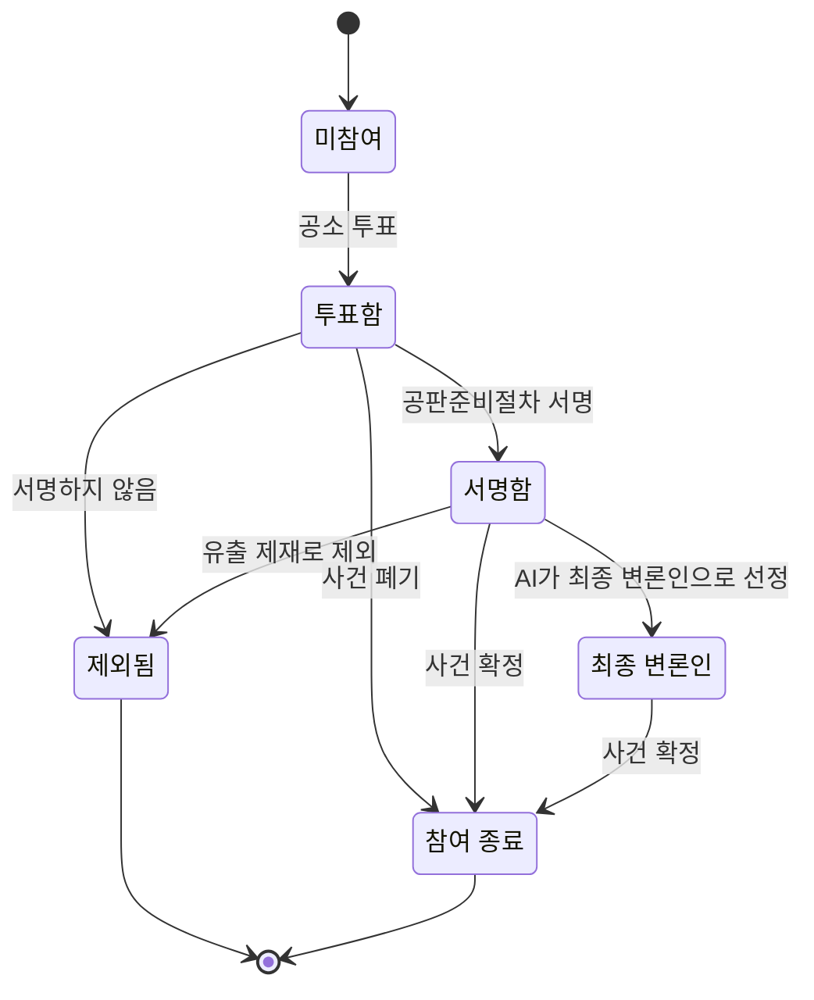

# 02. 사건 생애주기

사건 하나가 생성되어 폐기 또는 확정될 때까지 거치는 상태, 상태가 바뀌는 조건, 각 단계에서 누가 무엇을 할 수 있는지 정의합니다. 규칙의 근거는 [01. 서비스 정의](./01-service-definition.md)이며, 01에 없는 기간·조건은 **미정**으로 표시하고 제안값을 함께 적었습니다. 미정 항목은 맨 아래 [결정이 필요한 사항](#결정이-필요한-사항)에 모았습니다.

---

## 상태 흐름도

- 사건에는 `심급` 값(1심/2심)이 있습니다. 2심은 01의 핵심 흐름 10번에 따라 **증거 제출**(스레드 생성)부터 다시 진행하고, 공소 투표와 공판준비는 반복하지 않습니다.
- 끝나는 상태는 **폐기**와 **확정** 두 가지입니다. 사건이 이 두 상태에 도달해야 배심원은 다른 사건에 참여할 수 있습니다.

---

## 상태별 정의

| # | 상태 (코드) | 기간 | 진입 조건 | 다음 상태로 가는 조건 | 진행 주체 |
|---|---|---|---|---|---|
| 1 | 초안 (`DRAFT`) | 미정 | AI가 사건을 생성함 | 운영자가 검수 후 게시 | AI 생성, 운영자 게시 |
| 2 | 공소 투표 (`INDICTMENT_VOTE`) | 1주 또는 1달 | 운영자 게시 | 기간 만료 시 득표율 비교 | 배심원 투표 |
| 3 | 폐기 (`DISMISSED`) | 끝 | 불기소 득표율이 더 높음 | 없음 (같은 이름·사건ID·내용으로 다시 올릴 수 없음) | 시스템 |
| 4 | 공소 제기 대기 (`INDICTMENT_PENDING`) | 미정 (제안: 3일 이내) | 공소 제기 득표율이 더 높음 | 운영자가 공소 제기 실행 | 운영자 (AI는 공소 제기 불가) |
| 5 | 공판준비 (`PRETRIAL`) | 미정 (제안: 3일) | 운영자 공소 제기 | 서명 기간 만료 | 투표 참여 배심원 서명 |
| 6 | 증거 제출 (`EVIDENCE`) | 1달 | 서명 마감, 또는 2심 개시 | 기간 만료 시 양측 게시판 공개 | 운영자 진영 게시판 생성, 배심원 개인 스레드 작성 |
| 7 | 최종 변론인 선정 (`ADVOCATE_SELECTION`) | 미정 (제안: 1주) | 증거 제출 기간 종료 | 추천 투표 마감 후 AI가 최종 1명 선정 | 배심원 추천 투표, AI 선정 |
| 8 | 최종 변론 (`FINAL_ARGUMENT`) | 미정 (제안: 3일) | 최종 변론인 확정 | 최종 변론 제출 또는 기간 만료 | 대표 배심원 1명 |
| 9 | 배심원 평결 (`DELIBERATION`) | 미정 (제안: 3일) | 최종 변론 종료 | 기간 만료 | 배심원 평결 투표 |
| 10 | 판결 작성 (`SENTENCING`) | 미정 (제안: 3일) | 평결 마감 | 운영자가 판결 선고 | 운영자 |
| 11 | 리뷰 (`REVIEW`) | 1주 | 판결 선고 | 기간 만료 시 심급과 이의 리뷰 여부 확인 | 배심원 리뷰·항소 신청 |
| 12 | 2심 결정 (`APPEAL_DECISION`) | 미정 (제안: 3일) | 1심 리뷰 기간 종료 + 이의 리뷰 1건 이상 | 운영자가 2심 개시 또는 기각 | 운영자 |
| 13 | 확정 (`FINALIZED`) | 끝 | 이의 리뷰 없음, 2심 기각, 또는 2심 리뷰 종료 | 없음 | 시스템 |

---

## 상태별로 배심원이 할 수 있는 일

| 상태 | 배심원이 할 수 있는 일 | 할 수 없는 일 |
|---|---|---|
| 초안 | — (공개되지 않음) | 사건 열람 |
| 공소 투표 | 사건 개요 열람, 공소 제기/불기소 중 하나에 투표 | 다른 사건과 동시 참여 |
| 공소 제기 대기 | 투표 결과 확인 | 투표 변경 |
| 공판준비 | 공판준비절차 서명 (AI가 만든 허구 사건이며 법률 자문이 아님을 확인) | 투표하지 않은 사람의 서명 |
| 증거 제출 | 자기 측 게시판 열람, 개인 스레드 작성(생각·증거자료) | 상대 측 게시판 열람·글 쓰기, 유출·유출 정보 게시 (적발 시 제재) |
| 최종 변론인 선정 | 후보 추천 투표, 공개된 양측 게시판 열람 | 최종 1명 직접 지정, 게시판에 새 글 쓰기 |
| 최종 변론 | 최종 변론 열람 (대표 배심원은 변론 작성) | 대표 배심원 외 변론 작성 |
| 배심원 평결 | 유죄/무죄 평결 투표 (개인 표 비공개) | 진행 중 득표율 확인 |
| 판결 작성 | 대기 | 판결 개입 |
| 리뷰 | 참여 리뷰 작성, 리뷰에 이의 신청 포함 | 리뷰 기간 밖의 항소 신청 |
| 2심 결정 | 대기 | 2심 여부 투표 |
| 폐기 · 확정 | 결과 열람, 다른 사건 참여 | 이의 제기 |

---

## 배심원의 진행 상태

사건 상태와 별개로, 배심원 한 명은 사건 안에서 아래 단계를 거칩니다.

- **진영은 투표로 정해집니다.** 공소 제기에 투표하면 공소 제기 측(검사 역할), 불기소에 투표하면 불기소 측(변호 역할) 게시판에 들어갑니다. 진영 게시판에 글을 쓰는 순간 자신의 입장이 공개됩니다.
- **한 번에 1개 사건만** 참여할 수 있습니다. 공소 투표를 하는 순간 그 사건에 묶이고, 사건이 폐기·확정되거나 본인이 제외되면 풀립니다.

---

## 진영 게시판 규칙

증거 제출 단계에서 운영자가 공소 제기 측과 불기소 측 게시판을 하나씩 만듭니다. 배심원은 자기 측 게시판에 X(구 트위터)처럼 개인 스레드를 작성합니다.

| 단계 | 자기 측 게시판 | 상대 측 게시판 |
|---|---|---|
| 증거 제출 | 읽기 · 쓰기 | 읽을 수 없음 |
| 최종 변론인 선정 ~ 확정 | 읽기 (쓰기 마감) | 읽기 (공개) |
| 폐기 · 확정 이후 | 읽기 (사건 기록으로 보관) | 읽기 |

- 증거 제출 기간에는 정보가 각 진영의 자원입니다. 상대의 전략을 모른 채 자기 측의 주장과 증거를 쌓습니다.
- 증거 제출 기간이 끝나면 양측 게시판이 모두 공개되고, 동시에 읽기 전용이 됩니다. 배심원은 양측의 주장과 증거를 모두 본 뒤 최종 변론인 추천과 평결에 참여합니다.
- 서명하지 않아 제외된 배심원은 게시판에 글을 쓸 수 없습니다.

### 정보 유출과 제재

본 서비스는 배심원 사이의 정보 유출을 기술적으로 막지 않고 그 결과에 책임지지 않지만, 적발되면 제재할 수 있습니다. 원칙은 [01. 정보 유출과 제재](./01-service-definition.md#정보-유출과-제재)를 따릅니다.

| 항목 | 내용 |
|---|---|
| 문제가 되는 시기 | 증거 제출 기간 (기간이 끝나면 어차피 양측 게시판이 공개되므로) |
| 제재 대상 | 자기 측 정보를 상대 측에 유출한 배심원, 유출된 정보를 상대 측 게시판에 게시한 배심원 |
| 탐지 방법 | 열람자별 워터마크, 복사 글 탐지, 비정상 열람 탐지, 배심원 신고 |
| 제재 단계 | 경고 → 게시판 쓰기 제한 → 해당 사건에서 제외 → 다음 사건 참여 제한 |
| 이의 신청 | 제재를 받은 배심원은 이의를 신청할 수 있음 |

- '해당 사건에서 제외'되면 배심원의 진행 상태는 **제외됨**이 되고, 1인 1사건 제한이 풀립니다. 단, '다음 사건 참여 제한'까지 받으면 정해진 기간 동안 새 사건에 참여할 수 없습니다.

---

## 투표 공개 원칙

| 투표 | 진행 중 | 마감 후 | 이유 |
|---|---|---|---|
| 공소 투표 | 득표율 숨김 | 득표율 공개. 개인 입장은 진영 게시판을 통해 드러남 (증거 제출 기간에는 같은 진영 안에서만) | 게시판은 공소 제기 이후에 생기므로 투표 중에는 개인 입장이 드러나지 않음. 앞선 투표가 뒤 투표에 영향을 주는 것을 막음 |
| 최종 변론인 추천 | 득표율 숨김 | 결과 공개 | 인기투표처럼 쏠리는 것을 막음 |
| 배심원 평결 | 득표율 숨김 | 합계만 공개, 개인 표 비공개 | 상대 측 증거에 설득된 배심원이 눈치 보지 않고 처음 입장과 다르게 투표할 수 있게 함 |

**설득 지표**: 판결 화면에 공소 투표 결과와 평결 결과를 나란히 보여 줍니다. 예를 들어 "공소 제기 62% → 유죄 평결 48%"는 불기소 측의 증거가 배심원 14%p를 설득했다는 뜻입니다. 이 차이가 "증거로 사건의 결말을 증명한다"는 핵심 경험이 실제로 일어났는지 보여 줍니다.

---

## 주체별 권한

| 행동 | AI | 운영자 | 배심원 | 시스템 |
|---|---|---|---|---|
| 사건 생성 | O | O | X | |
| 사건 게시 | X | O | X | |
| 공소 투표 | X | X | O | |
| 투표 결과 조작 | X | X | X | |
| 득표율 집계·상태 전환 | | | | O |
| 공소 제기 (재판 개시) | X | O | X | |
| 진영 게시판 생성 | X | O | X | |
| 자기 측 게시판에 스레드 작성 | X | X | O (증거 제출 기간에만) | |
| 상대 측 게시판 열람 | | O | 증거 제출 기간 종료 후 | |
| 상대 측 게시판에 글 쓰기 | X | X | X | |
| 유출 탐지 | | | | O |
| 유출 제재 | X | O | X | |
| 제재 이의 신청 | X | X | O | |
| 최종 변론인 후보 추천 | X | X | O | |
| 최종 변론인 최종 선정 | O | X | X | |
| 최종 변론 | X | X | 대표 1명만 | |
| 평결 | X | X | O | |
| 판결 선고 | X | O | X | |
| 리뷰·항소 신청 | X | X | O (리뷰 기간 안에만) | |
| 2심 결정 | X | O | X | |

---

## 예상 소요 기간

01에서 정한 기간만 더하면 1심은 최소 **약 6주**입니다(공소 투표 1주 + 증거 제출 1달 + 리뷰 1주). 제안값까지 넣으면 다음과 같습니다.

| 구간 | 최소 | 최대 |
|---|---|---|
| 공소 투표 | 1주 | 1달 |
| 공소 제기 대기 + 공판준비 | 6일 | 6일 |
| 증거 제출 | 1달 | 1달 |
| 변론인 선정 + 최종 변론 + 평결 + 판결 작성 | 16일 | 16일 |
| 리뷰 | 1주 | 1주 |
| **1심 합계** | **66일 (약 9.5주)** | **89일 (약 13주)** |
| 2심 (결정 3일 + 증거 제출부터 리뷰까지) | 약 8주 | 약 8주 |

'단기' 프로젝트라면 기간이 꽤 깁니다. 시연이나 테스트용으로 각 기간을 짧게 바꿀 수 있는 **운영자 설정값**을 두기를 권합니다.

---

## 결정이 필요한 사항

01에 정해져 있지 않거나, 02를 작성하며 새로 드러난 빈칸입니다. 오른쪽 제안을 기본값으로 적어 두었습니다.

| # | 질문 | 제안 |
|---|---|---|
| 1 | 공소 투표 마감 시 참여자가 최소 인원 50명에 못 미치면? | 투표 기간을 1회 연장하고, 그래도 미달이면 폐기 |
| 2 | 공소 제기와 불기소 득표율이 같으면? | 불기소 (형사 절차의 '의심스러울 때는 피고인에게 유리하게' 원칙) |
| 3 | ~~투표 중에 실시간 득표율을 보여 줄까?~~ | **결정됨**: 모든 투표는 진행 중 숨김, 마감 후 공개. 평결만 개인 표 비공개 ([투표 공개 원칙](#투표-공개-원칙)) |
| 4 | 각 미정 기간(공판준비, 변론인 선정, 최종 변론, 평결, 판결 작성, 2심 결정) | 위 표의 제안값 |
| 5 | 최종 변론인은 사건 전체에 1명인가, 양측에 1명씩인가? 01은 '대표 배심원 1명' | 양측 1명씩 (재판의 공정성을 체험하려면 양측 변론이 필요). 정하면 01도 함께 수정 |
| 6 | 배심원 평결 단계가 01의 핵심 흐름에는 없음. 01은 "운영자는 배심원의 평결을 참고해 판결을 선고"한다고만 씀 | 02처럼 평결 단계를 추가하고 01 핵심 흐름에도 반영 |
| 7 | 공판준비 서명을 하지 않은 배심원이 이미 투표한 표는? | 득표율은 그대로 유지하고, 재판 이후 단계에서만 제외 |
| 8 | 2심 판결 뒤에도 리뷰를 받는가? | 받되 항소는 불가 (교육용 피드백으로만 사용) |
| 9 | 2심에서 진영 게시판을 새로 만드는가, 1심 게시판을 이어 쓰는가? | 새로 만들고 1심 게시판은 읽기 전용으로 보관 |
| 11 | ~~상대 측 게시판을 읽을 수 있는가?~~ | **결정됨**: 증거 제출 기간에는 자기 측만, 기간이 끝나면 양측 모두 공개. 글은 언제나 자기 측에만 씀 ([진영 게시판 규칙](#진영-게시판-규칙)) |
| 12 | ~~정보 유출은 어떻게 다루는가?~~ | **결정됨**: 기술적으로 막지 않고 책임지지 않되, 유출한 사람과 유출 정보를 게시한 사람 모두 제재 ([정보 유출과 제재](#정보-유출과-제재)) |
| 13 | '다음 사건 참여 제한' 기간은? 제재 단계별 적발 기준(몇 번째 적발에 어느 단계)은? | 05 정책 문서에서 결정 |
| 10 | 2심은 1심 참여 배심원만 참여하는가? | 1심에서 서명한 배심원만 참여 |
