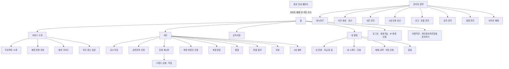

# 03. 정보 구조 · 화면 목록

서비스의 메뉴 구조(사이트맵), 화면 목록, 사건 상태별로 보여 줄 화면, 접근 권한, 알림을 정의합니다. 근거는 [01. 서비스 정의](./01-service-definition.md)와 [02. 사건 생애주기](./02-case-lifecycle.md)이며, 출발점은 홈페이지 시안 01의 메뉴입니다.

---

## 설계 원칙

1. **사이트 = 사건 하나**: 01의 [한 사이트, 한 사건](./01-service-definition.md#한-사이트-한-사건) 원칙에 따라 사이트에는 사건이 1건뿐입니다. 그래서 사건 목록이 없고, 홈과 사건 페이지가 모두 그 사건 하나를 중심으로 구성됩니다.
2. **사건 페이지 하나가 모든 단계를 보여 줌**: 사건은 여러 상태를 거치지만 상태마다 다른 페이지로 보내지 않습니다. 하나의 **사건 페이지**가 현재 상태에 맞는 화면(패널)을 보여 줍니다.
3. **지금 할 일을 맨 위에**: 사건 페이지 상단에는 언제나 현재 단계, 마감까지 남은 시간, 내가 지금 해야 할 일을 보여 줍니다.
4. **운영자 화면은 따로**: 운영자 기능은 일반 메뉴와 분리된 관리자 영역에 둡니다.
5. **끝나면 종료 안내 페이지만**: 사이트가 폐쇄되면 모든 주소가 종료 안내 페이지 하나로 연결됩니다.

---

## 사이트맵

### 상단 메뉴 (GNB)

| 시안 01 메뉴 | 제안 | 이유 |
|---|---|---|
| 홈 | 홈 | 그대로 |
| 프로젝트 소개 | **서비스 소개**로 묶음 | 프로젝트 소개, 재판 진행 과정, 참여 가이드, FAQ는 모두 '처음 온 사람이 읽는 글'이라 한 메뉴 아래 탭으로 묶습니다 |
| 재판 진행 과정 | 서비스 소개 안의 탭 | 위와 같음 |
| 참여하기 | **사건**에 합침 | 사건이 하나뿐이므로 참여는 곧 그 사건 페이지에서 시작됩니다. 참여 방법 설명은 '참여 가이드'로 옮깁니다 |
| 사건 목록 | **사건** | 사건이 1건뿐이라 목록이 필요 없습니다. 메뉴를 누르면 바로 사건 페이지로 갑니다 |
| 리뷰 & 재심 | **사건**에 합침 | 리뷰와 2심은 그 사건의 단계이므로 사건 페이지 안에서 보여 줍니다 |
| 공지사항 | 공지사항 | 그대로 |
| 로그인 · 회원가입 | 로그인 · 회원가입 / 로그인 후 **내 활동** | 로그인하면 내 활동과 알림을 보여 줍니다 |

결과적으로 상단 메뉴는 **홈 · 서비스 소개 · 사건 · 공지사항** 4개입니다.

---

## 화면 목록

화면 ID는 영역 머리글자와 번호로 만듭니다. 우선순위는 제안이며, MVP 범위는 이후 따로 확정합니다.

- **MVP**: 1심 한 바퀴(공소 투표 → 서명 → 게시판 → 변론인 선정 → 최종 변론 → 평결 → 판결)와 사이트 폐쇄까지 돌릴 수 있는 최소 화면
- **2차**: 리뷰, 2심, 정교한 유출 탐지, 배지 등

### 공개 영역

| ID | 화면 | 주요 내용 | 우선순위 |
|---|---|---|---|
| H-01 | 홈 | 안내 문구, **사건 요약**(사건명, 현재 단계, 마감까지 남은 시간, 참여자 수), 서비스 소개 요약, 재판 진행 과정, (로그인 시) 내 진영과 지금 할 일 | MVP |
| A-01 | 프로젝트 소개 | 만든 이유, 핵심 경험, 한 사이트 한 사건 원칙 | MVP |
| A-02 | 재판 진행 과정 | 01 핵심 흐름 13단계, 실제 재판과 다른 점(01 '실제로는 이렇습니다') | MVP |
| A-03 | 참여 가이드 | 계정 하나로 참여, IP 하나에 계정 하나(같은 네트워크에서는 한 사람만 참여), IP가 바뀌면 이메일 인증, 진영, 게시판 공개 시점, 정보 유출과 제재, 투표 공개 원칙, 사건이 끝나면 사이트가 폐쇄된다는 안내 | MVP |
| A-04 | 자주 묻는 질문 | | 2차 |
| N-01 | 공지사항 목록 · 상세 | "이 사건은 AI가 만들었습니다" 공지(사건 게시 때), 운영자의 결정 공지(2심 승인 기준, 폐쇄 일시 등) | MVP |
| L-01 | 이용약관 | 01 '배포와 운영에 관한 안내'를 반영 | MVP |
| L-02 | 개인정보처리방침 | 수집 항목(이메일, 비밀번호 해시, 닉네임, IP 해시, 열람 기록, 만 14세 미만이면 법정대리인 이름·이메일), 목적(서비스 제공, 다중 계정·유출 방지), 보관 기간(사이트 폐쇄까지), 폐쇄 시 파기. 가입 시 별도 동의 절차는 두지 않으므로 이 페이지가 유일한 안내 | MVP |
| L-03 | 문의하기 | | 2차 |
| X-01 | **종료 안내 페이지** | "이 사건은 종료되었습니다", 결과 요약(폐기 사유 또는 판결과 설득 지표), 회원 정보 파기 안내. 사이트 폐쇄 후 남는 유일한 화면 | MVP |

### 회원 영역

| ID | 화면 | 주요 내용 | 우선순위 |
|---|---|---|---|
| U-01 | 로그인 | 이메일·비밀번호. 등록 IP와 다르면 U-07로 이동 | MVP |
| U-02 | 회원가입 | 만 14세 이상/미만 선택(미만이면 법정대리인 이메일 입력 → U-08 동의 후 가입 완료), 이메일 인증, 닉네임 설정 (게시판에는 실명 대신 닉네임 표시), 계정 하나·IP 하나 안내, 개인정보처리방침 링크. 이미 다른 계정이 쓰는 IP면 가입 불가 안내 | MVP |
| U-07 | IP 변경 인증 | "접속 위치가 바뀌었습니다" 안내, 이메일 인증 코드 입력. 인증되면 등록 IP를 새 IP로 변경. 새 IP를 다른 계정이 쓰고 있으면 "이 네트워크에서는 이미 다른 계정이 이용 중입니다" 안내 | MVP |
| U-08 | 법정대리인 동의 | 법정대리인이 이메일 링크로 들어오는 화면. 서비스 소개, 자녀가 범죄를 다루는 가상 사건에 참여한다는 안내, 수집 항목, 동의/거부 버튼. 가입자에게는 동의 대기 화면(`/guardian-pending`: 요청 다시 보내기, 법정대리인 정보 고치기) | 2차 (M6) |
| U-03 | 내 활동 | 내 진영, 지금 할 일, 내 스레드·리뷰 | MVP |
| U-04 | 알림 | [알림](#알림) 표의 항목 | MVP |
| U-05 | 제재 내역 · 이의 신청 | 받은 제재, 이의 신청서 작성과 처리 상태 | MVP |
| U-06 | 배지 | 시안의 '획득한 배지'. 01·02에 아직 규칙이 없음 | 2차 |

### 사건 영역

모두 하나의 **사건 페이지** 안에서 상태에 따라 바뀌는 패널입니다.

| ID | 화면 | 보이는 상태 | 주요 내용 | 우선순위 |
|---|---|---|---|---|
| C-01 | 사건 페이지 · 공통 머리 | 항상 | 사건명, "AI가 만든 사건" 표시, 운영자 정리본(기준)과 **AI 원본 보기**, 단계 진행 막대, 마감 타이머, 내 진영, **지금 할 일**, (운영자가 기한을 넘기면) "운영자 조치 지연" 표시 | MVP |
| C-02 | 공소 투표 패널 | 공소 투표 | 사건 개요, 공소 제기/불기소 버튼, 투표 확인 창 | MVP |
| C-03 | 투표 결과 패널 | 공소 제기 대기, 폐기 | 득표율, 참여 인원, (폐기 시) 폐기 사유(불기소 또는 최소 인원 미달)와 사이트 폐쇄 예정 안내 | MVP |
| C-04 | 공판준비 서명 | 공판준비, 2심 배심원 모집 | 허구 사건·법률 자문 아님 확인 동의서, 서명 버튼, 서명 마감 시각 | MVP |
| C-05 | 진영 게시판 · 피드 | 증거 제출 ~ 확정 | X 형태 타임라인. 증거 제출 기간에는 자기 측 탭만, 기간이 끝나면 양측 탭. 열람자 워터마크, 신고 버튼 | MVP |
| C-06 | 스레드 상세 · 작성 | 증거 제출 (작성), 이후 (열람) | 개인 스레드와 이어지는 글, 증거자료 첨부, 출처 표시 | MVP |
| C-07 | 최종 변론인 선정 패널 | 최종 변론인 선정 | 자기 측 후보 목록과 추천 투표(추천 이유 작성), (추천 마감 후) AI의 진영별 추천과 이유, (운영자 선정 후) 최종 변론인과 운영자의 선정 이유 | MVP |
| C-08 | 최종 변론 패널 | 최종 변론 | 공소 제기 측 → 불기소 측 순서로 변론 열람. 변론인에게는 작성 화면 | MVP |
| C-09 | 평결 패널 | 배심원 평결 | 유죄/무죄 투표, "개인 표는 공개되지 않습니다" 안내 | MVP |
| C-10 | 판결 결과 패널 | 리뷰 ~ 확정 | 판결(무죄/유죄와 형량), 선고 이유, **설득 지표**(공소 투표 → 평결 비교), (확정 시) 사이트 폐쇄 예정 안내 | MVP |
| C-11 | 리뷰 패널 | 리뷰 ~ 확정 | 리뷰 목록과 작성, 이의 신청 체크(1심만), 리뷰 댓글 | 2차 (M5) |
| C-12 | 2심 참여 패널 | 2심 배심원 모집 | 1심 배심원: 참여 여부 선택. 리뷰 댓글 작성자: 참여 신청과 진영 선택. 운영자가 공개한 승인 기준·진영별 인원. 1심/2심 기록 탭 | 2차 (M5) |

### 관리자 영역

| ID | 화면 | 주요 내용 | 우선순위 |
|---|---|---|---|
| O-01 | 대시보드 | **운영자의 조치가 필요한 일**: 사건 검수, 공소 제기, 최종 변론인 선정, 판결 작성, 2심 결정, 2심 신청 승인, 신고 처리, 사이트 폐쇄 | MVP |
| O-02 | 사건 생성 · 검수 | AI 사건 생성 요청, 내용 편집, 실존 인물·사건 유사성 점검, 단계별 기간 설정(게시 전에만), **AI 원본 입력과 운영자 정리본 작성**, 게시와 동시에 "AI가 만든 사건" 공지 발행. **사이트당 1건이며, 게시 후에는 새 사건을 만들 수 없음** | MVP |
| O-03 | 사건 관리 | 상태별 조치(공소 제기, 최종 변론인 선정(AI 추천·배심원 추천 이유 확인, 진영별 1명 선정, AI 추천과 다르면 이유 입력, 확정 전 "한 번만 선정할 수 있습니다" 확인 창), 진영 게시판 생성, 판결 작성·선고, 2심 결정) | MVP |
| O-04 | 2심 신청 승인 | 신청자 목록, 진영별 인원, 승인 결과. 승인 기준과 진영별 상한은 O-03의 2심 개시 때 입력하고, 신청 마감 후 시스템이 기준대로 승인 (M5) | 2차 (M5) |
| O-05 | 신고 · 유출 관리 | 신고 목록, 탐지 결과(복사 글, 비정상 열람)와 근거(겹친 부분 표시, 원본을 열람한 회원, 열람 횟수·간격), 워터마크로 유출자 확인, 제재 부과, 탐지 기각(이유 기록), 이의 신청 처리 | MVP (신고·제재) / 2차 M7 (자동 탐지) |
| O-06 | 공지 관리 | | MVP |
| O-07 | 회원 관리 | 회원 검색, IP 차단·변경 기록, 다중 계정 의심 표시(IP를 계정끼리 번갈아 쓰는 경우 등) | MVP (IP 기록) / 2차 M7 (회원 화면 · 의심 표시) |
| O-08 | **사이트 폐쇄** | 폐쇄 일시 공지, 종료 안내 페이지 내용(결과 요약) 확인, 폐쇄 실행, 회원 정보 파기 실행 | MVP |

---

## 사건 상태별 화면

사건 페이지(C-01)에서 상태에 따라 보여 줄 패널과, 같은 시점에 운영자가 할 일을 정리했습니다.

| 상태 | 배심원에게 보이는 패널 | 지금 할 일 (배심원) | 운영자 화면 |
|---|---|---|---|
| 초안 | — (홈에 "곧 사건이 공개됩니다" 표시) | — | O-02 검수·게시 |
| 공소 투표 | C-02 | 투표하기 | — (마감 시 인원 미달이면 시스템이 자동 폐기) |
| 공소 제기 대기 | C-03 | 결과 기다리기 | O-03 공소 제기 |
| 폐기 | C-03 | 결과 확인하기 | O-08 폐쇄 일시 공지·폐쇄 실행 |
| 공판준비 | C-04 | 서명하기 | — |
| 증거 제출 | C-05, C-06 (자기 측만) | 스레드 쓰기 | O-03 진영 게시판 생성, O-05 신고 처리 |
| 최종 변론인 선정 | C-07, C-05 (양측 공개) | 후보 추천하기 | O-03 AI 추천 확인 후 진영별 최종 변론인 선정 (단 한 번) |
| 최종 변론 | C-08 | 변론 읽기 (변론인: 변론 쓰기) | — |
| 배심원 평결 | C-09 | 평결하기 | — |
| 판결 작성 | C-09 (마감 안내) | 판결 기다리기 | O-03 판결 작성·선고 |
| 리뷰 | C-10, C-11 | 리뷰 쓰기 | — |
| 2심 결정 | C-10, C-11 | 결정 기다리기 | O-03 2심 결정 |
| 2심 배심원 모집 | C-12, C-04 (승인된 신청자) | 참여 여부 선택 / 신청하기 / 서명하기 | O-04 신청 승인 |
| 확정 | C-10, C-11 | 결과 확인하기 | O-08 폐쇄 일시 공지·폐쇄 실행 |
| 사이트 폐쇄 | X-01 | — | — |

---

## 접근 권한

02의 배심원 진행 상태를 화면 접근에 연결했습니다. O = 볼 수 있음, ✎ = 쓸 수 있음, X = 볼 수 없음.

- **비로그인 사용자**는 사건 개요와 판결 결과까지만 볼 수 있습니다. 게시판, 최종 변론, 리뷰는 로그인 후에 볼 수 있습니다.
- **판결 선고 후**에는 사건에 참여하지 않은 로그인 사용자도 양측 게시판과 최종 변론을 읽을 수 있습니다. 리뷰에 댓글을 달고 2심을 신청하려면 사건 내용을 알아야 하기 때문입니다.
- '제외된 배심원'(서명하지 않았거나 유출 제재로 제외된 사람)은 사건에 참여하지 않은 사용자와 같게 취급합니다. 특히 증거 제출 기간에는 자기 측 게시판도 볼 수 없습니다. 유출로 제외된 사람이 계속 정보를 빼내지 못하게 하기 위해서입니다.
- **사이트 폐쇄 후**에는 누구나 종료 안내 페이지(X-01)만 볼 수 있고, 아래 표의 다른 화면은 모두 닫힙니다.

| 화면 | 비로그인 | 사용자 (미참여) | 배심원 (내 진영) | 배심원 (상대 진영) | 제외된 배심원 | 운영자 |
|---|---|---|---|---|---|---|
| 사건 개요 | O | O | O | O | O | O |
| 공소 투표 | X | ✎ | — | — | — | O |
| 공판준비 서명 | X | X | ✎ | ✎ | X | O |
| 진영 게시판 (증거 제출 기간) | X | X | ✎ | X | X | O |
| 진영 게시판 (기간 종료 후) | X | 판결 선고 후 O | O | O | 사용자와 같음 | O |
| 최종 변론인 추천 | X | X | ✎ (자기 측 후보만) | ✎ (자기 측 후보만) | X | O |
| 최종 변론 열람 | X | 판결 선고 후 O | O | O | 사용자와 같음 | O |
| 평결 | X | X | ✎ | ✎ | X | O (합계만) |
| 판결 결과 | O | O | O | O | O | O |
| 리뷰 열람 | X | O | O | O | O | O |
| 리뷰 작성 · 이의 신청 | X | X | ✎ | ✎ | X | O |
| 리뷰 댓글 | X | ✎ | ✎ | ✎ | X | O |
| 2심 참여 신청 | X | ✎ (리뷰 댓글 작성자) | 참여 여부 선택 | 참여 여부 선택 | X | O |
| 종료 안내 페이지 (폐쇄 후) | O | O | O | O | O | O |

---

## 알림

사건은 기간 단위로 진행되므로, 단계가 바뀔 때 알림을 보내지 않으면 배심원이 마감을 놓칩니다.

| 시점 | 받는 사람 | 내용 |
|---|---|---|
| 새 IP로 접속 (이메일) | 해당 회원 | IP 변경 인증 코드 |
| 공소 투표 마감 | 투표한 배심원 | 결과(공소 제기 / 불기소로 폐기 / 인원 미달로 폐기) |
| 법정대리인 동의 요청 (이메일) | 만 14세 미만 가입자의 법정대리인 | 동의 요청과 동의 링크 |
| 공판준비 시작 · 마감 하루 전 | 투표한 배심원 | 서명 요청, 서명하지 않으면 제외된다는 안내 |
| 증거 제출 시작 | 서명한 배심원 | 진영 게시판 열림 |
| 증거 제출 마감 3일 전 · 하루 전 | 서명한 배심원 | 마감 임박, 마감 후 양측 게시판이 공개된다는 안내 |
| 최종 변론인 선정 시작 · 결과 | 배심원 | 추천 투표 요청, 선정 결과 |
| 최종 변론인으로 선정됨 | 해당 배심원 | 변론 작성 요청과 마감 시각 |
| 평결 시작 · 마감 하루 전 | 배심원 | 평결 요청 |
| 판결 선고 | 배심원 | 판결 결과, 리뷰 기간 안내 |
| 2심 개시 | 1심 배심원, 리뷰 댓글 작성자 | 참여 여부 선택 또는 참여 신청 안내 |
| 2심 신청 승인 · 미승인 | 신청자 | 결과, (승인 시) 서명 요청 |
| 제재 부과 · 이의 신청 결과 | 해당 배심원 | 제재 내용과 이유, 이의 신청 방법 |
| **사이트 폐쇄 예고** | 모든 회원 | 폐쇄 일시, 그 전에 결과를 확인하라는 안내, 폐쇄 시 회원 정보가 파기된다는 안내 |
| 운영자 조치 필요 | 운영자 | O-01 대시보드 항목 발생 |

---

## 주소 구조 (제안)

개발 단계에서 쓸 기본 주소 구조입니다. 사건이 1건뿐이므로 주소에 사건 ID가 없습니다.

| 주소 | 화면 |
|---|---|
| `/` | H-01 홈 (폐쇄 후에는 X-01 종료 안내 페이지) |
| `/about`, `/about/process`, `/about/guide`, `/about/faq` | A-01 ~ A-04 |
| `/case` | C-01 사건 페이지 (상태별 패널) |
| `/case/board/:side` | C-05 진영 게시판 (`side` = `indict` 공소 제기 측, `dismiss` 불기소 측) |
| `/case/threads/:threadId` | C-06 스레드 상세 |
| `/case/evidence/:evidenceId?w=코드` | 증거 이미지. 그 게시판을 읽을 수 있는 사람에게만, 화면의 워터마크 코드를 새겨 보냄 (M7) |
| `/case/reviews` | C-11 리뷰 |
| `/notices`, `/notices/:noticeId` | N-01 |
| `/me`, `/me/notifications`, `/me/sanctions` | U-03 ~ U-05 |
| `/login`, `/signup`, `/verify-ip`, `/guardian/:token` | U-01, U-02, U-07, U-08 |
| `/terms`, `/privacy`, `/contact` | L-01 ~ L-03 |
| `/admin/...` | O-01 ~ O-08 (`/admin/reports` O-05, `/admin/members` O-07) |

- 2심은 주소를 따로 만들지 않고 `/case?round=2`처럼 같은 사건 안에서 심급을 바꿔 봅니다.
- 사이트가 폐쇄되면 모든 주소는 `/`의 종료 안내 페이지로 연결됩니다.

---

## 시안 수정 필요 사항

01의 '시안 수정 필요 사항'에 더해, 정보 구조 관점에서 바꿀 부분입니다.

| 시안 위치 | 현재 시안 | 03 기준 |
|---|---|---|
| 상단 메뉴 | 7개 (프로젝트 소개, 재판 진행 과정, 참여하기, 사건 목록, 리뷰 & 재심 따로) | 4개 (홈 · 서비스 소개 · 사건 · 공지사항) |
| 진행 중인 사건 (카드 3개) | 사건 여러 건 나열 | 사건 하나의 요약을 크게 표시 |
| 리뷰 & 재심 시스템 섹션 | 홈의 독립 섹션 | 사건 페이지의 리뷰 단계로 옮김 |
| 푸터 '참여 > 커뮤니티' | 커뮤니티 메뉴 | 뺌. 토론은 진영 게시판에서만 이뤄짐 |
| 나의 활동 '획득한 배지' | 배지 3개 표시 | MVP에서는 뺌. 배지는 2차에 규칙을 정한 뒤 추가 |
| 히어로 버튼 '사건 참여하기' | | 사건 페이지로 이동 |
| (새로 필요) | 없음 | 종료 안내 페이지(X-01) 시안 |

---

## 결정 기록

| # | 질문 | 결정 |
|---|---|---|
| 1 | 판결 선고 후 진영 게시판과 최종 변론을 사건에 참여하지 않은 사용자도 볼 수 있나? | 판결 선고 후에는 로그인 사용자 모두에게 공개 (02 권한표도 함께 수정) |
| 2 | 비로그인 사용자에게 어디까지 보여 줄까? | 사건 개요, 판결 결과까지. 게시판, 최종 변론, 리뷰는 로그인 후 |
| 3 | 시안 푸터의 '커뮤니티'는 무엇인가? | 뺌. 토론은 진영 게시판에서만 이뤄짐 |
| 4 | 배지는 무엇으로 받나? | 2차로 미룸. 후보: 첫 서명, 최종 변론인 선정, 설득 지표가 높은 진영 소속 등 |
| 5 | ~~참여 중인 사건이 있는 사용자가 다른 사건 상세에 들어가면?~~ | 해당 없음. 사이트에 사건이 1건뿐 |
| 6 | 사건 목록과 '리뷰 & 2심' 메뉴가 필요한가? | 없앰. 한 사이트 한 사건 원칙에 따라 상단 메뉴는 홈 · 서비스 소개 · 사건 · 공지사항 4개 |
| 7 | 사이트 폐쇄 후 화면은? | 종료 안내 페이지(X-01)만 남기고 모든 주소를 그곳으로 연결 |
| 8 | 다중 계정은 어떻게 막나? | 이메일 인증 + IP 하나에 계정 하나. IP가 바뀌면 이메일 인증(U-07). 같은 네트워크에서는 한 사람만 참여 가능 |
