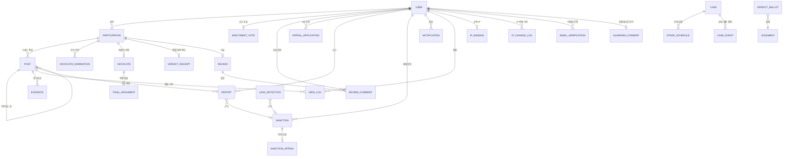

# 04. 데이터 모델

서비스가 저장해야 할 데이터(엔티티), 각 데이터의 필드, 서로의 관계, 규칙을 지키기 위한 제약 조건, 사이트 폐쇄 때 무엇을 파기하는지를 정의합니다. 근거는 [01](./01-service-definition.md) · [02](./02-case-lifecycle.md) · [03](./03-information-architecture.md) 문서입니다.

기술 스택이 아직 정해지지 않았으므로 특정 데이터베이스에 묶이지 않는 **논리 모델**로 씁니다. 타입은 `id`, `text`, `int`, `bool`, `datetime`, `enum`, `json` 같은 일반적인 이름을 쓰고, 이름은 `snake_case`로 적습니다.

---

## 설계 원칙

1. **사건은 1건뿐**: [한 사이트, 한 사건](./01-service-definition.md#한-사이트-한-사건) 원칙에 따라 `case` 테이블에는 행이 최대 1개만 들어갑니다. 다른 테이블은 사건 ID 대신 **심급(`round`, 1 또는 2)**으로 1심과 2심 데이터를 구분합니다.
2. **결정은 기록으로 남김**: 운영자는 결과를 조작할 수 없고 결정과 이유를 공개해야 하므로, 모든 상태 전환과 운영자 결정을 `case_event`에 남깁니다.
3. **평결은 누가 누구에게 투표했는지 알 수 없게**: 평결은 개인 표 비공개이므로, '투표했다는 사실'과 '투표 내용'을 서로 연결되지 않는 두 테이블에 나눠 저장합니다.
4. **폐쇄 때 지울 것을 미리 구분**: 개인정보가 담긴 테이블과 종료 안내 페이지에 남길 데이터를 처음부터 나눠 둡니다.
5. **IP는 원문으로 저장하지 않음**: IP 하나에 계정 하나 규칙을 지키려면 IP가 같은지만 비교하면 되므로, IP는 비밀 키를 쓰는 해시(HMAC)로만 저장합니다. IP는 경우의 수가 적어서 일반 해시는 쉽게 되돌릴 수 있기 때문입니다. 비밀 키는 사이트를 폐쇄할 때 함께 폐기합니다.

---

## 관계도

`VERDICT_BALLOT`(평결 내용)은 일부러 `USER`나 `PARTICIPATION`과 연결하지 않습니다.

---

## 엔티티

### 1. 회원과 사이트

#### `user` 회원

| 필드 | 타입 | 설명 |
|---|---|---|
| `id` | id | |
| `email` | text, 유일 | 로그인 아이디로 씀 |
| `email_verified_at` | datetime | 이메일 인증을 마친 시각. 인증 전에는 참여 불가 |
| `is_under_14` | bool | 가입할 때 선택. `true`이면 법정대리인 동의 전까지 계정이 활성화되지 않음 |
| `password_hash` | text | 비밀번호는 해시로만 저장 |
| `nickname` | text, 유일 | 게시판에 보이는 이름. 실명을 쓰지 않음 |
| `role` | enum | `member` 일반 회원, `operator` 운영자 |
| `created_at` | datetime | |

#### `ip_binding` 등록 IP (계정 하나에 IP 하나)

| 필드 | 타입 | 설명 |
|---|---|---|
| `user_id` | id, 유일 | 계정마다 등록 IP는 하나 |
| `ip_hash` | text, 유일 | IP를 비밀 키 해시(HMAC)한 값. 다른 계정이 같은 IP를 등록할 수 없음 |
| `verified_at` | datetime | 가입 또는 IP 변경 인증을 마친 시각 |

#### `ip_change_log` IP 변경 기록

| 필드 | 타입 | 설명 |
|---|---|---|
| `id` | id | |
| `user_id` | id | |
| `old_ip_hash` · `new_ip_hash` | text | |
| `result` | enum | `approved` 변경됨, `blocked_in_use` 다른 계정이 쓰는 IP라 차단, `failed_verification` 인증 실패 |
| `created_at` | datetime | |

운영자는 이 기록으로 IP를 계정끼리 번갈아 쓰는 등의 의심 행동을 찾습니다(03 O-07).

#### `email_verification` 이메일 인증

| 필드 | 타입 | 설명 |
|---|---|---|
| `id` | id | |
| `user_id` | id | |
| `purpose` | enum | `signup` 가입, `ip_change` IP 변경 |
| `code_hash` | text | 인증 코드는 해시로만 저장 |
| `attempts` | int | 틀린 횟수. 5번 틀리면 이 코드는 더 쓸 수 없음 (05) |
| `pending_ip_hash` | text, 선택 | IP 변경 인증일 때 바꾸려는 IP |
| `expires_at` · `used_at` | datetime | |

#### `guardian_consent` 법정대리인 동의 (만 14세 미만)

| 필드 | 타입 | 설명 |
|---|---|---|
| `id` | id | |
| `user_id` | id, 유일 | |
| `guardian_name` | text | 법정대리인 이름 |
| `guardian_email` | text | 동의 요청을 보내는 곳 |
| `token_hash` | text | 동의 링크 토큰 (해시) |
| `status` | enum | `pending` 대기, `consented` 동의, `refused` 거부, `expired` 만료 |
| `requested_at` · `responded_at` · `expires_at` | datetime | |

법정대리인이 동의하지 않거나 기한 안에 응답하지 않으면, 가입 신청 정보와 법정대리인 정보를 바로 삭제합니다.

#### `case` 사건 (최대 1행)

| 필드 | 타입 | 설명 |
|---|---|---|
| `id` | id | 1행만 허용 |
| `title` | text | 사건명 |
| `summary` | text | 사건 개요 (비로그인에게도 공개) |
| `body` | text | 사건 전문. **운영자가 정리한 내용**으로, 사건 페이지의 기준 |
| `ai_original_body` | text | AI가 만든 원본. 정리본과 함께 공개 |
| `generated_by` | enum | `ai`, `operator` |
| `ai_model` | text, 선택 | 사건을 생성한 AI 모델 |
| `ai_generated_at` | datetime, 선택 | AI가 사건을 생성한 일시 (05 검수 체크리스트) |
| `review_checklist` | json, 선택 | 05 게시 전 검수 체크리스트에서 확인한 항목 |
| `review_note` | text | 운영자 검수 기록 (실존 인물·사건 유사성 점검 결과) |
| `status` | enum | 02의 15개 상태 코드 (`DRAFT` ~ `SITE_CLOSED`) |
| `round` | int | 현재 심급 (1 또는 2) |
| `min_participants` | int | 기본 50 |
| `max_participants` | int, 선택 | 운영자가 정함 |
| `appeal_criteria` | text, 선택 | 2심 추가 배심원 승인 기준 (공개) |
| `published_at` | datetime | 게시 시각. 이후 기간 설정 변경 불가 |
| `closure_scheduled_at` | datetime, 선택 | 공지한 폐쇄 일시 |
| `closure_summary` | text, 선택 | 종료 안내 페이지에 남길 결과 요약 (개인정보 없음) |
| `closed_at` | datetime, 선택 | 폐쇄 실행 시각 |

#### `stage_schedule` 단계 일정

| 필드 | 타입 | 설명 |
|---|---|---|
| `id` | id | |
| `round` | int | |
| `stage` | enum | 02의 상태 코드 |
| `duration_minutes` | int (분 단위) | 게시 전에 운영자가 조정 가능. 시연 모드에서 분 단위로 줄일 수 있도록 분 단위로 저장 (06) |
| `starts_at` · `ends_at` | datetime | 단계에 들어갈 때 확정 |

#### `case_event` 상태 전환 · 운영자 결정 기록

| 필드 | 타입 | 설명 |
|---|---|---|
| `id` | id | |
| `round` | int | |
| `from_status` · `to_status` | enum | |
| `actor_type` | enum | `system`, `operator`, `ai` |
| `actor_user_id` | id, 선택 | 운영자일 때 |
| `decision` | enum, 선택 | `dismiss_for_quorum` 인원 미달 자동 폐기(시스템), `indict` 공소 제기, `open_appeal` 2심 개시, `reject_appeal` 2심 기각, `close_site` 폐쇄 등 |
| `reason` | text, 선택 | 결정 이유 |
| `is_public` | bool | 사건 페이지에 공개하는지 (운영자 결정은 항상 `true`) |
| `created_at` | datetime | |

수정·삭제할 수 없는 기록으로만 씁니다.

### 2. 참여와 투표

#### `participation` 배심원 참여 (회원 × 심급)

| 필드 | 타입 | 설명 |
|---|---|---|
| `id` | id | |
| `user_id` | id | |
| `round` | int | |
| `side` | enum | `indict` 공소 제기 측, `dismiss` 불기소 측 |
| `joined_via` | enum | `indictment_vote` 공소 투표, `continued` 1심에서 이어서, `appeal_application` 2심 신청 승인 |
| `status` | enum | 02의 배심원 진행 상태: `voted`, `signed`, `excluded`, `advocate`, `done` |
| `signed_at` | datetime, 선택 | 공판준비절차 서명 시각 |
| `excluded_reason` | enum, 선택 | `unsigned` 미서명, `sanction` 제재, `declined_round2` 2심 불참 |
| `created_at` | datetime | |

#### `indictment_vote` 공소 투표

| 필드 | 타입 | 설명 |
|---|---|---|
| `id` | id | |
| `user_id` | id, 유일 | 1인 1표 |
| `choice` | enum | `indict`, `dismiss` |
| `voted_at` | datetime | |

서명하지 않은 사람의 표도 지우지 않습니다(02 결정 7).

#### `advocate_nomination` 최종 변론인 후보 추천

| 필드 | 타입 | 설명 |
|---|---|---|
| `id` | id | |
| `round` | int | |
| `voter_participation_id` | id | |
| `candidate_participation_id` | id | 추천한 사람과 같은 진영이어야 함 |
| `reason` | text | 추천 이유. 운영자가 선정할 때 참고 |
| `created_at` | datetime | |

#### `advocate` 최종 변론인 (진영별 1명)

| 필드 | 타입 | 설명 |
|---|---|---|
| `id` | id | |
| `round` · `side` | int · enum | |
| `ai_recommended_participation_id` | id, 선택 | AI가 추천한 후보. AI가 응답하지 않았으면 비어 있음 |
| `ai_rationale` | text, 선택 | AI의 추천 이유 (공개) |
| `ai_request` · `ai_response` | text, 선택 | AI에 보낸 내용과 받은 답 원문 (기록용) |
| `participation_id` | id | 운영자가 최종 선정한 변론인 |
| `selected_by` | enum | `operator` 운영자 선정, `ai_default` 운영자가 기한 안에 선정하지 않아 AI 추천으로 확정, `vote_default` AI 추천도 운영자 선정도 없어 추천 표를 가장 많이 받은 후보로 확정 |
| `operator_reason` | text, 선택 | 운영자의 선정 이유. AI 추천과 다른 사람을 선정하면 필수 (공개) |
| `selected_at` | datetime | |

한 번 저장하면 수정할 수 없습니다. 운영자의 선정 기회가 단 한 번이라는 규칙(01)을 데이터로 지키기 위해서입니다.

#### `advocate_recommendation` AI 추천 (진영별 1건)

| 필드 | 타입 | 설명 |
|---|---|---|
| `id` | id | |
| `round` · `side` | int · enum | 유일 |
| `participation_id` | id, 선택 | AI가 추천한 후보. AI가 설정되지 않았거나 응답하지 않았으면 비어 있음 |
| `rationale` | text | 추천 이유, 또는 추천이 없는 이유 (공개) |
| `provider` · `model` | text, 선택 | 사용한 AI 제공자와 모델 |
| `request` · `response` | text, 선택 | AI에 보낸 내용과 받은 답 원문 (기록용) |
| `created_at` | datetime | |

추천 투표가 마감되면 만들어지고, 운영자가 선정할 때 참고합니다. 운영자가 선정하면 같은 내용이 `advocate`에도 복사됩니다 (M3 구현에서 추가).

#### `verdict_receipt` 평결 참여 여부 / `verdict_ballot` 평결 내용

| 테이블 | 필드 | 설명 |
|---|---|---|
| `verdict_receipt` | `participation_id` (유일), `round` | '이 배심원은 투표했다'는 사실만 저장. 중복 투표를 막음 |
| `verdict_ballot` | `id`, `round`, `choice` (`guilty` / `not_guilty`) | 투표 내용만 저장. 회원·참여 ID와 시각을 저장하지 않음 |

두 테이블은 같은 처리 안에서 함께 기록하지만 서로를 가리키는 값이 없어서, 저장된 데이터만으로는 누가 어디에 투표했는지 알 수 없습니다. `verdict_ballot`의 `id`가 순서대로 매겨지면 기록 순서로 추측할 수 있으므로, 무작위 ID를 씁니다.

### 3. 진영 게시판

#### `post` 스레드 글

| 필드 | 타입 | 설명 |
|---|---|---|
| `id` | id | |
| `round` · `side` | int · enum | 어느 심급, 어느 진영 게시판인지 |
| `author_participation_id` | id | |
| `root_post_id` | id, 선택 | 스레드의 첫 글. 첫 글이면 비어 있음 |
| `parent_post_id` | id, 선택 | 바로 위 글 (X처럼 이어 쓰기) |
| `body` | text | |
| `is_hidden` | bool | 운영자 숨김 처리 (제재, 유출 정보 게시 등) |
| `hidden_reason` | text, 선택 | |
| `created_at` · `updated_at` | datetime | |

글을 고칠 때마다 이전 내용을 `post_revision`(`post_id`, `body`, `revised_at`)에 남깁니다. 유출 글을 올렸다가 고쳐서 흔적을 지우는 일을 막기 위해서입니다.

#### `evidence` 증거자료

| 필드 | 타입 | 설명 |
|---|---|---|
| `id` | id | |
| `post_id` | id | |
| `type` | enum | `link` 링크, `image` 이미지, `text` 인용문 |
| `url_or_file_key` | text | |
| `source_note` | text | 출처 |
| `created_at` | datetime | |

#### `final_argument` 최종 변론 (진영별 1건)

| 필드 | 타입 | 설명 |
|---|---|---|
| `id` | id | |
| `round` · `side` | int · enum | |
| `advocate_id` | id | |
| `body` | text | |
| `submitted_at` | datetime | |

### 4. 정보 유출과 제재

#### `view_log` 열람 기록

| 필드 | 타입 | 설명 |
|---|---|---|
| `id` | id | |
| `user_id` | id | |
| `post_id` | id | |
| `watermark_code` | text | 이 열람에 표시한 워터마크 코드. 계정과 연결되어 있어, 캡처가 퍼졌을 때 열람자를 찾는 데 씀. IP는 쓰지 않음 |
| `viewed_at` | datetime | |

비정상 열람 탐지는 계정별 열람 횟수와 간격으로 판단합니다.

#### `report` 신고

| 필드 | 타입 | 설명 |
|---|---|---|
| `id` | id | |
| `reporter_user_id` | id | |
| `target_post_id` | id | |
| `reason` | enum | `leak` 유출 의심, `abuse` 비방, `other` 기타 |
| `detail` | text | |
| `status` | enum | `open`, `reviewing`, `resolved`, `rejected` |
| `handled_by` · `handled_at` · `resolution_note` | | 운영자 처리 기록 |
| `created_at` | datetime | |

#### `leak_detection` 자동 탐지 결과 (2차)

| 필드 | 타입 | 설명 |
|---|---|---|
| `id` | id | |
| `type` | enum | `copy_similarity` 복사 글, `abnormal_view` 비정상 열람, `watermark_match` 워터마크 일치 |
| `target_post_id` | id, 선택 | 상대 측 게시판에 올라온 의심 글 |
| `source_post_id` | id, 선택 | 원본 글 |
| `suspect_user_id` | id, 선택 | |
| `score` | int | 유사도 등 |
| `status` | enum | `open`, `confirmed`, `dismissed` |
| `detected_at` | datetime | |

#### `sanction` 제재 / `sanction_appeal` 제재 이의 신청

| 테이블 | 필드 | 설명 |
|---|---|---|
| `sanction` | `id`, `user_id`, `round`, `level` (`warning` 경고 / `write_ban` 쓰기 제한 / `excluded` 사건에서 제외), `violation` (`leak` 유출 / `leak_post` 유출 정보 게시 / `mass_leak` 대량 유출 / `multi_account` 다중 계정 / `abuse` 비방·혐오, 05 위반 유형), `reason`, `report_id`·`detection_id` (근거, 선택), `issued_by`, `issued_at` | `excluded`이면 해당 `participation.status`도 `excluded`로 바뀜 |
| `sanction_appeal` | `id`, `sanction_id`, `body`, `status` (`pending` / `accepted` / `rejected`), `decided_by`, `decision_note`, `created_at`, `decided_at` | |

### 5. 판결, 리뷰, 2심

#### `judgment` 판결 (심급별 1건)

| 필드 | 타입 | 설명 |
|---|---|---|
| `id` | id | |
| `round` | int, 유일 | |
| `outcome` | enum | `guilty` 유죄, `not_guilty` 무죄 |
| `sentence_type` | enum, 선택 | `prison` 징역, `probation` 집행유예, `fine` 벌금 |
| `sentence_detail` | text, 선택 | 기간·금액 |
| `reasoning` | text | 선고 이유 |
| `baseline_indict_ratio` | 소수 | 설득 지표의 기준. 1심은 공소 제기 득표율, 2심은 2심 시작 시 공소 제기 측 인원 비율 |
| `verdict_guilty` · `verdict_not_guilty` | int | 평결 집계 결과 (마감 시 저장) |
| `pronounced_by` · `pronounced_at` | | |

#### `review` 리뷰 / `review_comment` 리뷰 댓글

| 테이블 | 필드 | 설명 |
|---|---|---|
| `review` | `id`, `round`, `author_participation_id`, `body`, `rating` (1~5, 선택), `is_appeal` (항소 신청 여부, 1심만), `created_at` | 배심원 1명이 심급마다 리뷰 1건 |
| `review_comment` | `id`, `review_id`, `author_user_id`, `body`, `created_at` | 사건에 참여하지 않은 사용자도 작성 가능 |

#### `appeal_application` 2심 참여 신청

| 필드 | 타입 | 설명 |
|---|---|---|
| `id` | id | |
| `user_id` | id, 유일 | 리뷰 댓글을 단 사용자만 신청 가능 |
| `requested_side` | enum | 신청할 때 고른 진영 |
| `status` | enum | `pending`, `approved`, `rejected` |
| `reviewed_by` · `reviewed_at` · `note` | | |
| `created_at` | datetime | |

승인되면 `participation`(round 2, `joined_via = appeal_application`)이 만들어집니다. 1심 배심원이 2심에 참여하면 1심 진영 그대로 `participation`(round 2, `joined_via = continued`)이 만들어집니다.

### 6. 공지와 알림

| 테이블 | 필드 | 설명 |
|---|---|---|
| `notice` | `id`, `title`, `body`, `author_user_id`, `is_pinned`, `published_at` | 운영자 결정 공지, 폐쇄 일시 공지 등 |
| `notification` | `id`, `user_id`, `type`, `payload` (json), `link`, `read_at`, `created_at` | 03 [알림](./03-information-architecture.md#알림) 표의 항목 |

---

## 규칙을 지키는 제약 조건

01~03의 규칙 중 데이터로 지킬 수 있는 것과, 애플리케이션 코드로 확인해야 하는 것을 나눴습니다.

| 규칙 | 데이터 제약 | 코드에서 확인 |
|---|---|---|
| 사이트에 사건은 1건 | `case`에 행 1개만 허용 (예: `id`를 고정값으로 제한) | 게시 후 새 사건 생성 화면 막기 |
| 공소 투표는 1인 1표 | `indictment_vote.user_id` 유일 | 투표 기간에만 허용 |
| 한 사람은 계정 하나로만 참여 | `user.email` 유일 | 이메일 인증을 마친 계정만 참여 허용 |
| IP 하나에 계정 하나 | `ip_binding.user_id` 유일, `ip_binding.ip_hash` 유일 | 요청마다 접속 IP를 해시해 등록 IP와 비교. 다르면 IP 변경 인증으로 보내고, 새 IP가 다른 계정에 등록돼 있으면 차단 |
| 심급마다 참여는 한 번 | `participation` (`user_id`, `round`) 유일 | |
| 1심 배심원은 2심에서 진영 유지 | | round 2 `continued` 행의 `side` = round 1 `side` |
| 변론인 후보 추천은 자기 측 후보에게만 | | 추천자와 후보의 `side`가 같은지 확인 |
| 최종 변론인 · 최종 변론은 진영별 1명 · 1건 | `advocate`, `final_argument` (`round`, `side`) 유일 | |
| 운영자의 최종 변론인 선정은 단 한 번 | `advocate` 행은 수정 불가 | AI 추천과 다른 사람을 고르면 `operator_reason` 필수. 단계 마감까지 선정하지 않으면 AI 추천으로 저장 |
| 평결은 1인 1표, 개인 표 비공개 | `verdict_receipt.participation_id` 유일, `verdict_ballot`에 사람 정보 없음 | 같은 처리 안에서 두 테이블 기록 |
| 판결은 심급별 1건 | `judgment.round` 유일 | |
| 항소 신청은 1심 리뷰에서만 | | `round = 2`인 리뷰는 `is_appeal = false` |
| 2심 신청은 리뷰 댓글 작성자만 | `appeal_application.user_id` 유일 | 해당 회원의 `review_comment`가 있는지 확인 |
| 증거 제출 기간에는 자기 측 게시판만 | | 현재 상태와 열람자의 `side`로 조회 범위 제한 |
| 게시판 쓰기는 증거 제출 기간, 서명한 배심원만 | | 현재 상태, `participation.status`, 쓰기 제한 제재 여부 확인 |
| 운영자는 결과를 조작할 수 없음 | 투표 테이블에 운영자 수정 기능을 두지 않음 | 모든 운영자 결정은 `case_event`에 이유와 함께 기록 |
| 기간은 게시 전에만 조정 | | `case.published_at` 이후 `stage_schedule.duration` 수정 거부 |

---

## 구현에서 추가한 데이터

M0 구현(`prisma/schema.prisma`)에서 문서의 엔티티 외에 추가한 데이터입니다. 모두 사이트 폐쇄 때 파기합니다.

| 테이블 · 필드 | 설명 |
|---|---|
| `session` | 로그인 세션. 토큰 원문은 브라우저 쿠키에만 있고, DB에는 해시(`token_hash`)만 저장. `totp_verified`는 관리자 2단계 인증을 통과한 세션인지 |
| `rate_limit_event` | 요청 횟수 제한 기록 (같은 IP 가입 시도 하루 3회, 로그인 시도, 2단계 인증 시도 등) |
| `user.totp_secret_enc`, `user.totp_enabled_at` | 관리자 2단계 인증 비밀 값(암호화 저장)과 설정 완료 시각 |
| `email_verification.created_at` | 인증 코드 재발송 제한(60초)에 사용 |
| `notification.send_email`, `notification.emailed_at` | 이메일로도 보내야 하는 알림인지와 보낸 시각. 워커가 보내지 않은 것을 모아 발송 |

---

## 상태별로 생기는 데이터

| 사건 상태 | 새로 생기는 데이터 |
|---|---|
| 초안 | `case`, `stage_schedule` |
| 공소 투표 | `indictment_vote`, `participation` (round 1, `voted`) |
| 공소 제기 대기 · 폐기 | `case_event` (결과, 운영자 결정과 이유) |
| 공판준비 | `participation.signed_at`, 미서명자는 `excluded` |
| 증거 제출 | `post`, `post_revision`, `evidence`, `view_log`, `report`, `leak_detection`, `sanction` |
| 최종 변론인 선정 | `advocate_nomination`, `advocate` |
| 최종 변론 | `final_argument` |
| 배심원 평결 | `verdict_receipt`, `verdict_ballot` |
| 판결 작성 | `judgment` |
| 리뷰 | `review`, `review_comment` |
| 2심 배심원 모집 | `appeal_application`, `participation` (round 2) |
| 사이트 폐쇄 | `case.closure_summary`, `case.closed_at`, 이후 파기 |

모든 상태 전환에서 `case_event`와 `notification`이 함께 생깁니다.

---

## 사이트 폐쇄 때 파기하는 데이터

01 원칙에 따라 폐쇄할 때 회원 정보를 파기합니다. 구체적인 방법과 시점은 운영자가 관련 법률에 맞게 정합니다.

| 구분 | 테이블 | 처리 |
|---|---|---|
| **남김** | `case`의 `title`, `summary`, `status`, `closure_summary`, `closed_at` | 종료 안내 페이지(03 X-01)에 쓰임. 개인정보가 없어야 함 |
| **남김** | `judgment`의 판결·선고 이유·설득 지표 숫자 | 결과 요약에 쓰임 |
| **파기** | `user`, `participation`, `indictment_vote`, `verdict_receipt` | 회원 정보와 참여 기록 |
| **파기** | `ip_binding`, `ip_change_log`, `email_verification`, `guardian_consent`, `session`, `rate_limit_event`, IP 해시용 비밀 키 | IP, 인증, 세션, 법정대리인 정보 |
| **파기** | `post`, `post_revision`, `evidence`, `final_argument`, `review`, `review_comment` | 회원이 쓴 글 |
| **파기** | `view_log`, `report`, `leak_detection`, `sanction`, `sanction_appeal` | 열람 기록과 제재 기록 |
| **파기** | `appeal_application`, `advocate_nomination`, `advocate`, `notification` | |
| **파기** | `verdict_ballot`, `stage_schedule`, `case_event`, `notice` | 개인정보는 없지만 종료 안내 페이지에 필요 없음 |

`closure_summary`를 쓸 때 닉네임이나 글 내용을 옮겨 적지 않도록 주의합니다.

---

## 결정 기록

### 결정된 사항

| # | 질문 | 결정 |
|---|---|---|
| 1 | 로그인 방식은? | 이메일·비밀번호, 이메일 인증 필수 |
| 2 | IP는 어떻게 쓰나? | IP 하나에 계정 하나로 **차단**에 씀. IP가 바뀌면 이메일 인증 후 변경, 새 IP를 다른 계정이 쓰고 있으면 차단. 원문 대신 비밀 키 해시로 저장하고 폐쇄 시 파기. 워터마크에는 쓰지 않음 |
| 6 | 개인정보 동의는? | 서비스에 꼭 필요한 최소 항목만 받고 별도 동의 절차는 두지 않음. 단, '안내 없이'는 안 되므로 개인정보처리방침은 반드시 공개 ([01. 개인정보](./01-service-definition.md#개인정보-동의-없이는-가능할-수-있지만-안내-없이는-안-됩니다), 03 L-02) |

### 남은 질문

| # | 질문 | 제안 |
|---|---|---|
| 3 | 리뷰에 별점을 둘까? (시안: 4.6 / 5) | 선택 항목으로 둠 |
| 4 | 증거자료로 파일 업로드를 허용할까? | 링크, 이미지, 인용문만 허용. 이미지는 5MB 이하 4장까지 ([05. 게시판 · 증거자료 정책](./05-policy-and-risk.md#게시판--증거자료-정책)의 제안값) |
| 5 | 스레드 글을 고치거나 지울 수 있나? | 증거 제출 기간 안에서 수정 가능, 수정 이력은 보관. 삭제하면 배심원에게는 보이지 않게 숨기되 실제로 지우지 않고, 운영자는 계속 볼 수 있음 (유출 흔적을 지우는 것을 막기 위해) |
| 7 | ~~IP 변경 인증을 하루에 몇 번까지 허용할까?~~ | **결정됨**: 계정당 하루 5회 ([05. IP · 계정 정책](./05-policy-and-risk.md#ip--계정-정책)) |
| 8 | 계정이 IP를 바꾸고 나면 이전 IP는 바로 다른 계정이 쓸 수 있나? | 바로 풀어 줌. 다만 같은 IP가 계정 사이를 오가면 `ip_change_log`로 운영자에게 표시 |
